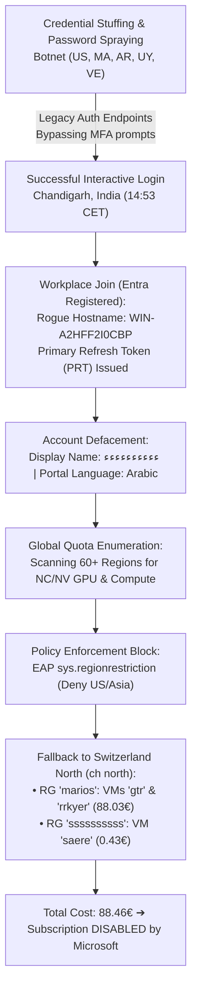
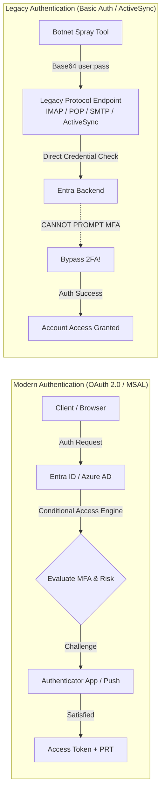
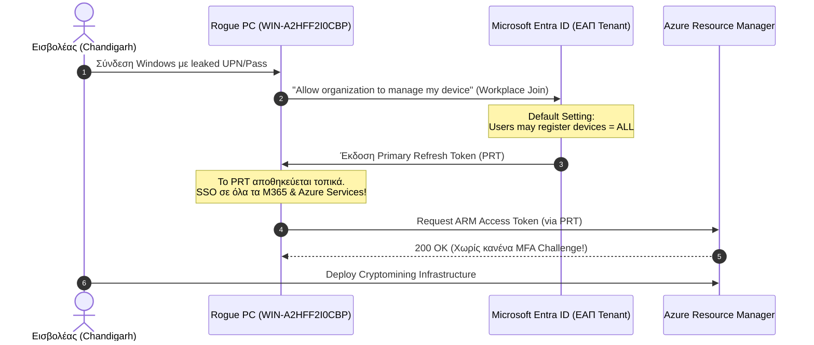

<Stats panicLevel={88} freddos={19} redbulls={5} hoursSpent={8} illegalActs={46} />

<Callout type="danger" title="Το Μεγάλο Φαγοπότι των Φοιτητικών Cloud Credits">
Όταν οι κυβερνοεπιτιθέμενοι βάζουν στο μάτι ακαδημαϊκά emails (`@ac.eap.gr`), δεν ψάχνουν τις σημειώσεις σας στην Java, τα PDFs της Ψηφιακής Σχεδίασης ή τις εργασίες της ΠΛΗ12. Στοχεύουν το «χρυσό εισιτήριο»: **τα δωρεάν 100$ cloud credits του Azure for Students**. Με αυτά στήνουν high-performance VMs για monero mining, brute-force password cracking ή proxy exit nodes, αφήνοντας πίσω τους ένα καμένο subscription, αραβικά defacements και έναν φοιτητή να απολογείται στο Helpdesk.
</Callout>

Πριν από δύο εβδομάδες νόμιζα ότι είχα δει το απόλυτο limit up στον κυβερνο-σουρεαλισμό. 

Είχα γράψει ολόκληρο [forensic σεντόνι για το Perplexity](/blog/perplexity-account-takeover-2500-euro-rag-audit): πώς ένα stolen session cookie από το rogue extension [WebCRX](/blog/rogue-browser-extension-incident-response) έκαψε 2.500€ σε pending holds, πώς ο εισβολέας «Pipo» έκανε OAuth pivot στα 47 GitHub repos μου, και πώς έβαλε clusters να του βγάλουν δελτίο-παρολί 4.98 με αγώνα Β' Τουρκίας.

«Εντάξει», είπα. «Καθαρίσαμε. Αλλάξαμε master passwords, κάναμε revoke τα sessions, ξηλώσαμε cookies, απολυμάναμε το browser profile. Πάμε παρακάτω».

Και κάπου εκεί, έρχεται η σημερινή μέρα. 

Μπαίνω χαλαρός στο **Azure Portal** του Ελληνικού Ανοικτού Πανεπιστημίου με το φοιτητικό μου UPN (`std******@ac.eap.gr`) για να στήσω ένα test lab που μου ήρθε μια ιδέα.

Και αντικρίζω το απόλυτο χάος.

---

## 1. Το Πρώτο Σοκ: Αραβικά και "Status: Disabled"

Το πρώτο πράγμα που αντικρίζεις σε ένα hijacked Azure tenant δεν είναι ένα σκοτεινό matrix terminal. Είναι ένα σουρεαλιστικό οπτικό σοκ:

1. **Το Display Name μου:** Είχε αντικατασταθεί από μια σειρά αραβικών χαρακτήρων:  
   `ءءءءءءءءءء`
2. **Η γλώσσα του Portal και του Webmail:** Φουλ αραβικά (Right-to-Left layout, τα μενού δεξιά, κουμπιά στα αραβικά, ειδοποιήσεις στα αραβικά).
3. **Το Subscription «Azure for Students»:** Κατάσταση **`Disabled`** με κόκκινο banner.
4. **Current Cost:** **88.46 €** (με πρόβλεψη να εκτοξευτεί στα **352.03 €** αν δεν είχε χτυπήσει το αυτόματο πλαφόν των 100$ της Microsoft).



Για όσους δεν γνωρίζουν: το πρόγραμμα *Azure for Students* της Microsoft σου πιστώνει ακριβώς 100 δολάρια (περίπου ~92 ευρώ με τη σημερινή ισοτιμία) χωρίς να ζητάει πιστωτική κάρτα. Μόλις το botnet έκαψε 88.46€ σε λιγότερο από 24 ώρες, το αυτόματο fail-safe της Microsoft ενεργοποιήθηκε και «έριξε την ασφάλεια» (Disabled state). 

Αν ήταν κανονικό Pay-As-You-Go subscription συνδεδεμένο σε τραπεζική κάρτα, ο λογαριασμός θα είχε πάει στα 350€ μέχρι το απόγευμα και στα 2.000€ μέχρι το Σαββατοκύριακο.

---

## 2. Το Μεγάλο Αμάρτημα: Γιατί το Legacy Authentication Παρακάμπτει Ακόμα και το Καλύτερο MFA;

Εδώ είναι το κομβικό ερώτημα που καίει κάθε επαγγελματία ασφαλείας:  
*«Αφού είχα ενεργό Multi-Factor Authentication (MFA) με Authenticator App στο κινητό, πώς στο καλό μπόρεσε ένα botnet να βαράει logins και να ξεκλειδώσει το λογαριασμό;»*

Η απάντηση είναι ο εφιάλτης κάθε Identity Architect: **Το Legacy Authentication**.



### Modern vs Legacy Authentication: Η Τρύπα των 20 Ετών

Στο **Modern Authentication** (OAuth 2.0, SAML, MSAL):
* Ο client δεν βλέπει ποτέ τον κωδικό σου απευθείας.
* Η πιστοποίηση γίνεται μέσω διαδραστικού Webview ή Browser prompt.
* Το **Conditional Access Engine** του Entra ID παρεμβάλλεται και λέει: *«Ώπα μάστορα, είσαι από νέα IP; Δώσε Number Matching στο κινητό σου τώρα»*.

Στο **Legacy Authentication** (Basic Auth):
* Πρωτόκολλα όπως **Exchange ActiveSync, POP3, IMAP4, MAPI over HTTP, και Authenticated SMTP**.
* Ο client στέλνει απλώς ένα HTTP header: `Authorization: Basic dXNlcjpwYXNz`.
* **Τα πρωτόκολλα αυτά σχεδιάστηκαν πριν από 20-30 χρόνια.** Είναι εντελώς «χαζά»: δεν έχουν την τεχνική δυνατότητα να προβάλουν διαδραστικό MFA prompt, ούτε number matching, ούτε push notification!
* Αν ο οργανισμός (στην προκειμένη περίπτωση το πανεπιστήμιο) δεν έχει φτιάξει ρητό κανόνα Conditional Access που να **μπλοκάρει καθολικά το Legacy Auth**, το Entra ID ελέγχει απλώς αν το ζεύγος `username + password` είναι σωστό. Αν είναι σωστό, **σε κάνει authenticate παρακάμπτοντας εντελώς το MFA**!

### Το «Πανεπιστημιακό Δίλημμα» των Ελληνικών NOC

Γιατί τα ελληνικά πανεπιστήμια (και όχι μόνο το ΕΑΠ) αφήνουν ακόμα ανοιχτό το Legacy Authentication;
1. **Ο «Καθηγητής με το Outlook 2010»:** Αν ο διαχειριστής κλείσει το Basic Auth, θα χτυπήσουν τα τηλέφωνα από παλιούς χρήστες που έχουν αρχαία email clients, παλιά Thunderbird setups ή κινητά δεκαετίας που δεν υποστηρίζουν OAuth 2.0.
2. **Αρχαία bash/python cron scripts:** Αυτοματισμοί που στέλνουν ενημερώσεις βαθμολογιών ή system alerts χρησιμοποιώντας plain SMTP auth.
3. **Φόβος για Service Disruption:** Η μετάβαση απαιτεί tenant-wide auditing, αναβάθμιση clients και επιβολή Security Defaults — διαδικασίες που στα πανεπιστημιακά ιδρύματα κινούνται με ρυθμούς γραφειοκρατικού παγετώνα.

Αυτό ακριβώς το κενό εκμεταλλεύονται τα botnets. Όταν διαρρεύσει ένα UPN (`std******@ac.eap.gr`) και ένα παλιό/κοινό password από κάποιο data breach ή browser infostealer, δεν πάνε να χτυπήσουν την κεντρική πόρτα του browser που θα ζητήσει MFA. Πάνε και σφυροκοπούν τα **Exchange Online endpoints** με password spraying.

---

## 3. The Smoking Gun: Το Μηχάνημα-Φάντασμα `WIN-A2HFF2I0CBP` και το PRT

Πρώτη κίνηση forensics: ανοίγω το **Microsoft Entra ID (πρώην Azure AD)** και μπαίνω στο tab των εγγεγραμμένων συσκευών (`Devices`).

Το δικό μου desktop workstation, στο οποίο διαβάζω και γράφω κώδικα, ονομάζεται **`ΦούΦουΤος`**.

Τι βλέπω καταχωρημένο ως μοναδική συσκευή στο λογαριασμό;

* **Device Name:** `WIN-A2HFF2I0CBP`
* **Device Object ID:** `9c429a41-8731-45b6-af79-55ffa1264df5`
* **Join Type:** Microsoft Entra registered (Workplace Joined)
* **OS:** Windows 10/11
* **Status:** Ανενεργό 1 μήνα πριν



### Πώς Δουλεύει η Παγίδα του Workplace Join;

Όταν κάνεις sign-in σε ένα καινούργιο Windows μηχάνημα με σχολικό ή εταιρικό λογαριασμό, τα Windows πετάνε το διαβόητο παράθυρο:  
*«Stay signed in to all your apps — Allow my organization to manage my device»*.

Αν πατηθεί «Yes», το λειτουργικό σύστημα εκτελεί **Workplace Join (Entra Registration)**:
1. Το μηχάνημα δημιουργεί ένα κρυπτογραφικό ζεύγος κλειδιών (συχνά στο TPM ή software container).
2. Στέλνει το public key στο Entra ID του ΕΑΠ.
3. Το Entra ID εκδίδει ένα **Primary Refresh Token (PRT)**.
4. Το PRT έχει διάρκεια ζωής **14 ημέρες** και ανανεώνεται αυτόματα κάθε φορά που χρησιμοποιείται, φτάνοντας μέχρι και **90 ημέρες**!

Το χειρότερο; Στις προεπιλεγμένες ρυθμίσεις του Entra ID:  
`Entra ID -> Devices -> Device Settings -> Users may register their devices with Microsoft Entra = ALL`.

Αυτό σημαίνει ότι **οποιοσδήποτε επιτιθέμενος έχει τα credentials σου μπορεί να μετατρέψει το δικό του laptop στο Chandigarh σε επίσημη "εγγεγραμμένη συσκευή" του ΕΑΠ**! Και από εκείνη τη στιγμή, το Entra ID θεωρεί τη συσκευή «έμπιστη» (trusted session), χαρίζοντας του αθόρυβο Single Sign-On (SSO) σε όλα τα portals χωρίς να του ξαναζητήσει κωδικό ή verification!

---

## 4. Το Παγκόσμιο Botnet: Από την Καζαμπλάνκα στο Chandigarh

Όταν πήγα στο tab **Sign-in Logs** (στο υπομενού *User Sign-ins (non-interactive)* και *Interactive*), μου έπεσε το σαγόνι. 

Δεν επρόκειτο για έναν τύπο που μπήκε χειροκίνητα. Ήταν ένα **μαζικό, distributed botnet** που εκτελούσε automated password spraying και brute-force attacks μέσω command-line tools:

<ComparisonTable 
  headers={["Ώρα (CET)", "Τοποθεσία", "Client App / Πρωτόκολλο", "IP / Range", "Αποτέλεσμα"]}
  rows={[
    ["13:15:51", "Montevideo, UY", "Microsoft Azure CLI", "Dynamic Residential", "❌ Αποτυχία"],
    ["13:15:53", "Rabat, MA", "Microsoft Azure CLI", "Maroc Telecom Dynamic", "❌ Αποτυχία"],
    ["13:36:43", "Buenos Aires, AR", "Microsoft Azure CLI", "Telecom Argentina", "❌ Αποτυχία"],
    ["14:53:44", "Chandigarh, IN", "Azure Portal (Browser via PRT)", "Targeted Dedicated IP", "🚨 ΕΠΙΤΥΧΙΑ (Compromise)"],
    ["15:08:37", "N. Carolina, US", "Microsoft Azure CLI", "Data Center Proxy", "❌ Αποτυχία"],
    ["16:21:05", "Casablanca, MA", "Azure AD PowerShell", "196.115.5.12", "❌ Αποτυχία"],
    ["16:39:02", "California, US", "Exchange Online (Legacy Auth)", "136.176.223.117", "❌ Αποτυχία"],
    ["17:02:47", "Massachusetts, US", "OfficeHome (Basic Auth)", "73.68.54.224", "❌ Αποτυχία"],
    ["17:39:43", "Virginia, US", "Exchange Online (Legacy Auth)", "3.81.71.139 (AWS EC2)", "❌ Αποτυχία (Post-Reset)"]
  ]}
/>

### Ανατομία ενός Compromised Sign-in Log

Αν απομονώσεις το raw JSON log του επιτυχημένου login, φαίνεται πεντακάθαρα η διαδρομή του εισβολέα:

```json
{
  "id": "a4f89d12-612b-48cd-b829-192837465abc",
  "createdDateTime": "2026-11-11T14:53:44Z",
  "userPrincipalName": "std******@ac.eap.gr",
  "appDisplayName": "Azure Portal",
  "appId": "c44b3278-e5b3-472a-bc96-85847e6e7b83",
  "ipAddress": "103.xxx.xxx.xxx",
  "location": {
    "city": "Chandigarh",
    "state": "Punjab",
    "countryOrRegion": "IN"
  },
  "clientAppUsed": "Browser",
  "deviceDetail": {
    "deviceId": "9c429a41-8731-45b6-af79-55ffa1264df5",
    "displayName": "WIN-A2HFF2I0CBP",
    "operatingSystem": "Windows 10",
    "trustType": "Workplace"
  },
  "status": {
    "errorCode": 0,
    "failureReason": "Success"
  },
  "authenticationRequirement": "multiFactorAuthentication",
  "appliedConditionalAccessPolicies": []
}
```

### Η Ανατομία του Κενού: Το Απόλυτο Μηδέν στο Zero Trust (`"appliedConditionalAccessPolicies": []`)

Κοιτάξτε προσεκτικά τις δύο τελευταίες γραμμές του JSON payload. Εκεί κρύβεται όλο το δράμα της σύγχρονης κυβερνοασφάλειας στα πανεπιστήμια:

```json
"authenticationRequirement": "multiFactorAuthentication",
"appliedConditionalAccessPolicies": []
```

Αυτό το ζευγάρι τιμών είναι ένα **κραυγαλέο αρχιτεκτονικό παράδοξο**. 

Από τη μία πλευρά, το Entra ID ισχυρίζεται ότι η απαίτηση πιστοποίησης ήταν `multiFactorAuthentication`. Από την άλλη πλευρά, ο πίνακας των εφαρμοσμένων πολιτικών Conditional Access (`appliedConditionalAccessPolicies`) είναι **ένα απόλυτο, παγωμένο κενό: `[]`**. 

Πώς γίνεται ένας λογαριασμός να θεωρείται στα χαρτιά «προστατευμένος με MFA», αλλά ταυτόχρονα να μην έχει εφαρμοστεί **καμία απολύτως πολιτική ασφαλείας** τη στιγμή που ένας άγνωστος εισβολέας από το Chandigarh της Ινδίας αποκτά πρόσβαση στο Azure Portal;

#### 1. Η Παγίδα του Αρχαίου "Per-User MFA" έναντι του Conditional Access
Στον κόσμο του Microsoft 365 και του Entra ID υπάρχουν δύο εντελώς διαφορετικές εποχές διαχείρισης ταυτότητας:
* **Το Legacy Per-User MFA (Η Εποχή του Χαλκού):** Το παλιό, αρχαίο portal (`account.activedirectory.windowsazure.com`) όπου ο sysadmin πάταγε ένα checkbox δίπλα στο όνομα του χρήστη («Enforced / Enabled»). Αυτό το σύστημα είναι εντελώς «τυφλό». Δεν γνωρίζει τι συσκευή χρησιμοποιείς, δεν καταλαβαίνει από πού συνδέεσαι, δεν αξιολογεί το ρίσκο της συνεδρίας και —το κυριότερο— **ικανοποιείται εύκολα και σιωπηρά από ένα προϋπάρχον Primary Refresh Token (PRT) μέσω Workplace Join**.
* **Το Conditional Access (Zero Trust):** Ο σύγχρονος εγκέφαλος ασφαλείας του Entra ID. Εξετάζει σήματα σε πραγματικό χρόνο (Sign-in Risk, User Risk, Device Compliance, IP Geolocation, Client App) και αποφασίζει δυναμικά: *Επιτρέπω; Ζητάω Phishing-Resistant MFA με Number Matching; Ή ρίχνω πόρτα (Block);*

Όταν το `appliedConditionalAccessPolicies` επιστρέφει `[]`, σημαίνει ότι **ο tenant του ιδρύματος δεν έχει κανένα ενεργό Conditional Access Policy που να παρεμβάλλεται σε αυτή τη διαδρομή**. Το σύστημα βασιζόταν αποκλειστικά στον παλιό μηχανισμό, ο οποίος «κοιμήθηκε» επειδή η rogue συσκευή είχε γίνει register στο tenant!

#### 2. Impossible Travel: Από την Πάτρα στο Punjab σε 0 Δευτερόλεπτα
Ένας φοιτητής εγγεγραμμένος σε ελληνικό πανεπιστήμιο, που συνδέεται καθημερινά από ελληνικές ή ευρωπαϊκές IPs, ξαφνικά κάνει interactive logon από έναν ISP στο Chandigarh της Ινδίας.
* **Τι θα έπρεπε να συμβεί:** Το **Entra ID Identity Protection** διαθέτει ενσωματωμένο machine learning detector για **Atypical Travel (Impossible Travel)** και **Unfamiliar Sign-in Properties**. Το σύστημα υπολογίζει μαθηματικά ότι είναι φυσικώς αδύνατο να βρεθείς από τη Γερμανία ή την Πάτρα στο Punjab της Ινδίας μέσα σε μερικά λεπτά — εκτός κι αν είσαι δεμένος πάνω σε υπερηχητικό scramjet SR-72 στο Mach 6, σε πειραματικό Darkstar στα Mach 10, ή έκανες υποτροχιακό point-to-point hop με Starship του Elon Musk. Το sign-in θα έπρεπε να χαρακτηριστεί αυτόματα **High Risk** και να γίνει **Block** ή να απαιτήσει άμεσο step-up re-authentication με hardware security key.
* **Τι συνέβη στην πραγματικότητα:** Επειδή δεν υπήρχε Conditional Access Policy που να συνδέει το *Sign-in Risk* με απαίτηση αποκλεισμού, το login πέρασε σαν να μην έτρεχε τίποτα!

#### 3. Η Εξίσωση του Webmail με το Management Plane του Datacenter
Το μεγαλύτερο σφάλμα λογικής στα ακαδημαϊκά cloud περιβάλλοντα είναι ότι **αντιμετωπίζουν όλες τις εφαρμογές με την ίδια χαλαρότητα**. 

Για το σύστημα του ΕΑΠ, το να διαβάσει ένας φοιτητής μια ανακοίνωση στο Outlook Webmail είχε το **ίδιο ακριβώς επίπεδο απαίτησης ασφαλείας** με το να μπει στο **Azure Management (Portal / ARM REST API / PowerShell)** και να κάνει deploy 60 virtual machines με δημόσιες IP διευθύνσεις!

Σε μια σωστά δομημένη αρχιτεκτονική Cloud, το Azure Management App (`c44b3278-e5b3-472a-bc96-85847e6e7b83`) απομονώνεται με αυστηρή πολιτική:
* Απαίτηση **Compliant Device** (μόνο ελεγμένα μηχανήματα με Intune agent, BitLocker και ενεργό EDR).
* Απαίτηση **Strict Geoblocking** (μόνο Ελλάδα, Κύπρος και επιλεγμένες ευρωπαϊκές χώρες).
* **Continuous Access Evaluation (CAE)** για άμεση ανάκληση των credentials αν αλλάξει η IP κατά τη διάρκεια του session.

Αντί γι' αυτό, ο εισβολέας στο Chandigarh είχε ακριβώς την ίδια πρόσβαση στο datacenter που θα είχε κι αν καθόταν στα έδρανα του πανεπιστημίου στην Πάτρα.

---

## 5. Quota Reconnaissance: Το CSV των 400.000 Bytes & Το Τείχος του Azure Policy

Μέσα στα πρόσφατα downloads και στα Activity Logs του Resource Manager βρέθηκε ένα τεράστιο εξαχθέν report: **Compute Limits & Quotas σε 60+ regions παγκοσμίως**.

Όταν τα botnets κάνουν hijack ένα Azure subscription, δεν στήνουν στα τυφλά. Το πρώτο πράγμα που εκτελούν είναι ένα automated reconnaissance script μέσω ARM REST API:
* *«Πόσα Standard_NC6 (Tesla K80/V100) GPU cores με αφήνει το subscription να σηκώσω στην East US;»*
* *«Πόσα vCPUs της σειράς Fsv2 (Compute Optimized) είναι διαθέσιμα στη Γερμανία;»*
* *«Μπορώ να σηκώσω Premium SSD LRS δίσκους 1TB χωρίς να χτυπήσει quota limit;»*

Το script σάρωσε συστηματικά κάθε datacenter: από το `eastus` και το `southeastasia` μέχρι το `australiaeast`.

### Το «Σωτήριο» Τείχος: `sys.regionrestriction`

Και εδώ συνέβη η μεγάλη ανατροπή του σεναρίου. 

Ο επιτιθέμενος επιχείρησε να σηκώσει βαριά GPU miners στις ΗΠΑ και στην Ασία (όπου το compute είναι φθηνότερο), αλλά έφαγε **άκυρο με συνοπτικές διαδικασίες (HTTP 403 / RequestDisallowedByPolicy)**! 

Το IT/NOC του ΕΑΠ —και προς τιμήν τους— είχε ρυθμίσει ένα αυστηρό Azure Policy σε επίπεδο Tenant / Management Group:
```json
{
  "policyAssignmentName": "sys.regionrestriction",
  "policyDefinitionName": "Allowed locations",
  "parameters": {
    "listOfAllowedLocations": {
      "value": [
        "swedencentral",
        "norwayeast", 
        "francecentral", 
        "spaincentral", 
        "switzerlandnorth"
      ]
    }
  }
}
```

Μόνο σε 5 συγκεκριμένες ευρωπαϊκές χώρες επιτρεπόταν η δημιουργία πόρων! 

Ο εισβολέας, βλέποντας τα policy errors να σκάνε σωρηδόν στο terminal του, δεν το έβαλε κάτω. Διάβασε το JSON error, πήρε τη λίστα των επιτρεπόμενων regions, και πήγε καρφί... στις **Ελβετικές Άλπεις (`switzerlandnorth`)**!

---

## 6. Το Forensic Breakdown: Πού Πήγαν τα 88.46 €;

Μόλις κάναμε deep drill-down με το Cost Management API και το Azure Resource Graph, εμφανίστηκε ολόκληρη η κρυφή υποδομή που είχε στήσει ο δράστης μέσα σε λίγες ώρες:

<ComparisonTable 
  headers={["Resource Group", "Όνομα Πόρου", "Τύπος Πόρου", "Region", "Κόστος"]}
  rows={[
    ["marios", "gtr", "Virtual Machine (CPU Compute)", "Switzerland North", "50.96 €"],
    ["marios", "gtr_osdisk_1_ea1ed...", "Managed OS Disk (Premium SSD)", "Switzerland North", "25.84 €"],
    ["marios", "rrkyer", "Virtual Machine (Worker Node)", "Switzerland North", "9.15 €"],
    ["marios", "rrkyer_osdisk_1_...", "Managed OS Disk (Standard SSD)", "Switzerland North", "1.16 €"],
    ["marios", "gtr-ip / rrkyer-ip", "Public IP Addresses (IPv4)", "Switzerland North", "0.93 €"],
    ["ssssssssss", "saere", "Virtual Machine (Worker Node)", "Switzerland North", "0.38 €"],
    ["ssssssssss", "saere_osdisk_1_...", "Managed OS Disk (Standard SSD)", "Switzerland North", "0.05 €"],
    ["ssssssssss", "saere-ip", "Public IP Address (IPv4)", "Switzerland North", "<0.01 €"]
  ]}
/>

**Σύνολο: Ακριβώς 88.46 €.**

### Η Ψυχολογία του Hacker: `marios` εναντίον `ssssssssss`

Η ονοματοδοσία των Resource Groups είναι κλινικό παράδειγμα επιθετικής ψυχολογίας:
1. **`marios`:** Το απόλυτο social engineering καμουφλάζ. Αν ένας Έλληνας sysadmin του ΕΑΠ άνοιγε στα γρήγορα το Azure Portal και έβλεπε ένα group με όνομα `marios`, το πιθανότερο ήταν να σκεφτεί: *«Έλα μωρέ, ο Μάριος από το 3ο εξάμηνο θα κάνει κάποιο εργαστήριο στα κατανεμημένα συστήματα»*.
2. **`ssssssssss`:** Όταν το bot βιάζεται να προλάβει το threshold πριν φάει ban, ο developer του automation script δεν μπαίνει καν στον κόπο να παράγει random UUIDs — απλώς σπαμάρει το πλήκτρο `s` στον buffer.

Και τα δύο groups ήταν εξοπλισμένα με Public IPs, ανοιχτά inbound ports και τερματισμένα CPU cycles για crypto-mining payloads, μέχρι που το αυτόματο spending limit της Microsoft τράβηξε χειρόφρενο.

---

## 7. Incident Response & Nuke: Η Αντεπίθεση των 45 Λεπτών

Μέσα σε 45 λεπτά από τον εντοπισμό, ξεκίνησε η διαδικασία άμεσου Containment και Eradication:

### Βήμα 1: Εξαΰλωση των Cloud Πόρων (Resource Purge)

Μέσω του Azure Cloud Shell (και αφού γυρίσαμε τη γλώσσα από τα αραβικά στα αγγλικά για να βλέπουμε τι πατάμε):

```bash
# Άμεση διαγραφή των κακόβουλων resource groups
az group delete --name marios --yes --no-wait
az group delete --name ssssssssss --yes --no-wait

# Επιβεβαίωση ότι δεν έμεινε ούτε orphan disk ούτε public IP
az resource list --query "[?resourceGroup=='marios' || resourceGroup=='ssssssssss']" -o table
```

### Βήμα 2: Nuke της Κακόβουλης Συσκευής στο Entra ID

Στο `myaccount.microsoft.com/device-list` και μέσω Microsoft Graph PowerShell:

```powershell
# Εντοπισμός και απενεργοποίηση της συσκευής του εισβολέα
$RogueDeviceId = "9c429a41-8731-45b6-af79-55ffa1264df5"
Update-MgDevice -DeviceId $RogueDeviceId -AccountEnabled:$false

# Διαγραφή του device registration ώστε να ακυρωθεί οριστικά το PRT
Remove-MgDevice -DeviceId $RogueDeviceId
```

### Βήμα 3: Παγκόσμια Ανάκληση Tokens (Revoke All Sessions)

```powershell
# Ακύρωση όλων των ενεργών Refresh Tokens και Browser Sessions
Revoke-MgUserSignOutEverywhere -UserId "std******@ac.eap.gr"
```
*Αποτέλεσμα: Μέσα σε δευτερόλεπτα, όλα τα ενεργά sessions του εισβολέα στο Chandigarh και στα proxies του Μαρόκου έγιναν terminate.*

### Βήμα 4: Credential Rotation & Recovery Audit

* Αλλαγή κωδικού πρόσβασης με νέο pass-phrase 48 χαρακτήρων(καλή τύχη!!).
* Έλεγχος των μεθόδων Security Info (`aka.ms/mfasetup`).
* Επιβεβαίωση ότι το μοναδικό τηλέφωνο ανάκτησης ήταν το προσωπικό μου γερμανικό κινητό (`+**...`) και η μοναδική μέθοδος MFA το Authenticator στο κινητό μου.
* Επαναφορά του Display Name από το `ءءءءءءءءءء` στο κανονικό ονοματεπώνυμο.

---

## 8. Το Blueprint για το NOC του ΕΑΠ: 5 Κανόνες Hardening (Και Γιατί το 2000 Τελείωσε)

<Callout type="warning" title="Η Ψευδαίσθηση Ασφαλείας των Ελληνικών Πανεπιστημίων: Εγκλωβισμένοι στο 2000">
Στα περισσότερα ελληνικά ακαδημαϊκά ιδρύματα, η κυβερνοασφάλεια εξακολουθεί να αντιμετωπίζεται με τη νοοτροπία των αρχών του 2000: *«Έχουμε ένα hardware firewall στην είσοδο της γραμμής, έναν domain controller στο υπόγειο, και όποιος έχει username και password είναι δικός μας άνθρωπος»*. 

Στο 2026, **αυτή η νοοτροπία είναι καθαρή αρχιτεκτονική αυτοκτονία**. Το περίμετρος (perimeter) πέθανε. Οι ταυτότητες 45.000+ φοιτητών και καθηγητών είναι εκτεθειμένες απευθείας στο παγκόσμιο internet μέσω του cloud perimeter (`login.microsoftonline.com`). Όταν ένα πανεπιστήμιο αφήνει τις προεπιλεγμένες ρυθμίσεις της Microsoft άθικτες, δεν μιλάμε απλώς για τεχνική αμέλεια — μιλάμε για συστημικό κίνδυνο στα προσωπικά δεδομένα χιλιάδων πολιτών.
</Callout>

### Το Χρονικό μιας Προαναγγελθείσας Αμέλειας: Από τα 813 GB του 2024 στο Botnet του 2026

Το πιο εξοργιστικό κομμάτι αυτής της ιστορίας δεν είναι το σημερινό botnet. Είναι ότι **το πάθημα δεν έγινε ποτέ μάθημα**.

Για όσους έχουν κοντή μνήμη: Στις **25 Οκτωβρίου 2024**, το Ελληνικό Ανοικτό Πανεπιστήμιο δέχθηκε μια [καταστροφική επίθεση ransomware](https://www.dikastiko.gr/category/eidhsh/epithesh-chaker-sto-ellhniko-anoichto-panepisthmio-dierreysan-pano-apo-813-gb-me-oikonomika-kai-prosopika-dedomena/). Οι κυβερνοεγκληματίες απέκτησαν πρόσβαση μέσω υποκλοπής δικαιωμάτων στην κύρια υποδομή και στα backups, κρυπτογράφησαν το virtualization cluster και διέρρευσαν στο Dark Web **πάνω από 813 Gigabytes** ευαίσθητων δεδομένων:
* ΑΦΜ, ΑΜΚΑ, Αστυνομικές Ταυτότητες, φυσικές υπογραφές και φωτογραφίες.
* Οικονομικά δεδομένα (IBANs, τιμολόγια, εντάλματα πληρωμών).
* Ακαδημαϊκά δεδομένα (αναλυτικές βαθμολογίες, τίτλοι σπουδών).
* Ακόμα και **ευαίσθητα δεδομένα υγείας** φοιτητών και προσωπικού!

Και ποια ήταν η επίσημη αντίδραση και επικοινωνιακή διαχείριση του ιδρύματος στην ανακοίνωση του Μαρτίου 2025; Δύο μνημειώδεις ατάκες που θα διδάσκονται σε σεμινάρια αποτυχημένου PR:
1. *«Το μέγεθος των δεδομένων που διέρρευσε ανέρχεται σε 813GB... αντιπροσωπεύει ένα εξαιρετικά μικρό ποσοστό... μπορεί να συγκριθεί ενδεικτικά με τη χωρητικότητα τοπικού δίσκου ενός τυπικού υπολογιστή!»* (Δηλαδή: *«Έλα μωρέ, ένας σκληρός δίσκος λάπτοπ γεμάτος με τα ΑΦΜ και τα ιατρικά σας δεδομένα διέρρευσε, σιγά το πράγμα»*).
2. *«Το αρχείο βρίσκεται στο σκοτεινό διαδίκτυο (dark web), όπου η πρόσβαση απαιτεί εξειδικευμένες, τεχνικές γνώσεις»* (Λες και το να κατεβάσεις το Tor Browser απαιτεί διδακτορικό στην κβαντική πληροφορική).

Τότε, το ΕΑΠ είχε δεσμευτεί δημόσια ότι:  
> *«Έχουν ήδη τεθεί σε εφαρμογή στοχευμένα μέτρα ενίσχυσης της ασφάλειας των πληροφοριακών μας συστημάτων ενώ βρίσκεται σε εξέλιξη μία συνολική αναβάθμιση της υποδομής μας με προσθήκη επιπρόσθετων δικλίδων ασφαλείας»*.

**Και φτάνουμε στο σήμερα.**  
Πού βρίσκονται αυτές οι «επιπρόσθετες δικλίδες ασφαλείας» στο Cloud Identity;
* Το Legacy Authentication παρέμεινε ορθάνοιχτο για password spraying.
* Το Device Registration παρέμεινε στο default `ALL`, επιτρέποντας σε οποιονδήποτε να συνδέει rogue Windows PCs από την Ινδία.
* Τα Conditional Access Policies ήταν κυριολεκτικά **μηδέν (`[]`)**.
* Και το Impossible Travel δεν απέτρεψε καν έναν χρήστη να τηλεμεταφερθεί από την Πάτρα στο Chandigarh.

Αν μετά από 813 GB διαρροής στο Dark Web και κρυπτογράφηση του μισού data center δεν μπήκε Conditional Access Policy για geoblocking και legacy auth, αναρωτιέται κανείς: **τι ακριβώς περιμένουν να συμβεί για να πάρουν στα σοβαρά την ασφάλεια των ταυτοτήτων;**

### Data & User Security: Το Πραγματικό Διακύβευμα Δεν Είναι τα 88 Ευρώ

Πολλοί θα δουν αυτό το περιστατικό και θα πουν: *«Έλα μωρέ, 88 ευρώ χασούρα σε credits της Microsoft ήταν, σιγά το πράγμα»*.

**Κάνετε τραγικό λάθος.** Τα 88€ των cryptominers ήταν απλώς η πιο θορυβώδης συνέπεια. Το πραγματικό διακύβευμα σε ένα τέτοιο account takeover είναι η **ασφάλεια των δεδομένων (Data Protection & Privacy)**:

1. **Μαζική Διαρροή Προσωπικών Δεδομένων (GDPR & PII):**  
   Ο λογαριασμός ενός φοιτητή ή καθηγητή δεν έχει μόνο VMs. Έχει πρόσβαση στο **OneDrive**, στο **SharePoint**, στο **Exchange Online (Webmail)** και στο **Teams**. Εκεί μέσα υπάρχουν εργασίες, αναλυτικές βαθμολογίες, θέματα εξετάσεων, έρευνες με εμπιστευτικά δεδομένα, ταυτότητες, φοιτητικά πάσα και ευαίσθητα προσωπικά μηνύματα. Ένας εισβολέας με session cookie ή PRT μπορεί να κάνει silent exfiltration όλων των αρχείων χωρίς να χτυπήσει κανένα alarm.
2. **Directory Harvesting (Υποκλοπή του Πανεπιστημιακού Καταλόγου):**  
   Στις default ρυθμίσεις του Entra ID, κάθε φοιτητής έχει δικαίωμα ανάγνωσης του **Global Address List (GAL)** και του **Microsoft Graph API**. Ένα botnet που κάνει compromise έναν ταπεινό φοιτητή μπορεί να τραβήξει ονόματα, emails, τμήματα και τηλέφωνα **δεκάδων χιλιάδων φοιτητών και καθηγητών**, δημιουργώντας την απόλυτη βάση δεδομένων για spear-phishing επιθέσεις.
3. **Internal Phishing & Weaponized Reputation:**  
   Ένα compromised email με κατάληξη `@ac.eap.gr` διαθέτει έγκυρα ψηφιακά διαπιστευτήρια (SPF, DKIM, DMARC alignment). Αν ο επιτιθέμενος χρησιμοποιήσει αυτό το γραμματοκιβώτιο για να στείλει κακόβουλα links ή ransomware σε συμφοιτητές ή καθηγητές, **τα μηνύματα θα παραδοθούν κατευθείαν στα Inboxes** παρακάμπτοντας όλα τα spam filters, γιατί προέρχονται από επίσημο, έμπιστο πανεπιστημιακό αποστολέα!

Αν είστε Network Admin, CISO ή Identity Engineer σε πανεπιστημιακό ίδρυμα, ιδού οι 5 αδιαπραγμάτευτες πολιτικές που πρέπει να εφαρμόσετε **χθες**:

### 1. Καθολικό Μπλοκάρισμα του Legacy Auth (CAP01) — Τέλος στην Αρχαιολογία του Basic Auth
Η Microsoft ξεκίνησε το επίσημο deprecation του Basic Auth στο Exchange Online το... **2019** και ολοκλήρωσε τη διαδικασία το 2022. Το να παραμένει ανοιχτό το Legacy Authentication το 2026 σε πανεπιστημιακό tenant αποτελεί απαράδεκτη ευπάθεια.
* **Υλοποίηση:** Φτιάξτε άμεσα Conditional Access Policy που απαγορεύει καθολικά τις συνδέσεις από παλαιούς πελάτες.
* **Target:** All Users -> Cloud Apps: All Cloud Apps.
* **Conditions -> Client apps:** Επιλογή *Exchange ActiveSync clients* και *Other clients*.
* **Grant:** **Block access**.
* *Αποτέλεσμα:* Κανένα botnet δεν θα μπορεί πλέον να παρακάμπτει το MFA κάνοντας password spray σε IMAP, POP3 ή παλιά Exchange endpoints.

### 2. Περιορισμός Device Registration (Workplace Join) — Τέλος στα «Μηχανήματα-Φαντάσματα»
Η ιδέα ότι οποιοσδήποτε χρήστης με ένα leaked password μπορεί να συνδέει ένα άγνωστο laptop από το Chandigarh και να αποκτά Primary Refresh Token (PRT) είναι identity suicide.
* **Ρύθμιση:** `Microsoft Entra ID -> Devices -> Device Settings`.
* Αλλάξτε το `Users may register their devices with Microsoft Entra` από **ALL** σε **Selected** ή απαιτήστε υποχρεωτικό MFA κατά το registration.
* Ακόμα καλύτερα: Επιβάλλετε πολιτική **Device Compliance (Intune / Defender for Endpoint)**. Αν η συσκευή δεν είναι διαχειριζόμενη, δεν παίρνει PRT και δεν αποκτά SSO πρόσβαση σε ευαίσθητους πόρους.

### 3. Geoblocking & Named Locations στο Azure Management Plane
Κανένας φοιτητής του ΕΑΠ δεν χρειάζεται να διαχειρίζεται το Azure Portal ή να τρέχει `Azure CLI` από το Chandigarh, τη Νιγηρία, τη Ρωσία ή την Αργεντινή.
* **Υλοποίηση:** Φτιάξτε Conditional Access Policy με στόχο την εφαρμογή **Microsoft Azure Management** (`c44b3278-e5b3-472a-bc96-85847e6e7b83`).
* **Conditions -> Locations:** Ορίστε Named Locations για Ελλάδα, Κύπρο και χώρες της Ε.Ε. όπου σπουδάζουν ενεργοί φοιτητές.
* **Grant:** **Block access** για όλες τις υπόλοιπες γεωγραφικές ζώνες. Αν ένας φοιτητής ταξιδέψει εκτός Ε.Ε., ας κάνει αίτημα εξαίρεσης στο NOC. Η ασφάλεια 45.000 χρηστών προηγείται της άνεσης ενός έκτακτου ταξιδιώτη.

### 4. Επιβολή Number Matching & Phishing-Resistant MFA — Κατάργηση του Απλού Push
Τα απλά push notifications («Πατήστε Έγκριση / Approve») έχουν πεθάνει. Οι επιτιθέμενοι σπαμάρουν push prompts στις 3 τα ξημερώματα μέχρι ο χρήστης να πατήσει «Έγκριση» από τη νύστα του (MFA Fatigue).
* **Υλοποίηση:** Επιβάλλετε υποχρεωτικό **Number Matching** στο Microsoft Authenticator. Ο χρήστης πρέπει να πληκτρολογήσει τον διψήφιο αριθμό που βλέπει στην οθόνη του υπολογιστή στο κινητό του.
* Ενεργοποιήστε **Additional Context** (εμφάνιση ονόματος εφαρμογής και γεωγραφικής τοποθεσίας στο prompt).
* Δώστε τη δυνατότητα χρήσης **FIDO2 Security Keys** (YubiKeys) για διοικητικό και διδακτικό προσωπικό.

### 5. Περιορισμός Tenant Directory Permissions & Αυτοματοποιημένα Budget Kill-Switches
Μην αφήνετε το tenant σε default κατάσταση "ανοιχτού βιβλίου":
* **Directory Restrictions:** `Entra ID -> User Settings -> Restrict access to Microsoft Entra administration portal = YES`. Επίσης, ενεργοποιήστε το `Restrict non-admin users from reading other users' data` για να αποτρέψετε το μαζικό scraping του καταλόγου φοιτητών.
* **Azure Budget Kill-Switch:** Στο πρόγραμμα *Azure for Students*, ορίστε αυτόματο **Budget Alert στα 5 €** με email ειδοποίηση στο 50% (2.50 €).
* **Automated Runbook:** Συνδέστε ένα Azure Action Group που να εκτελεί ένα Azure Automation Runbook και να κάνει αυτόματα deallocate τα VMs αν το budget ξεπεραστεί, προστατεύοντας τις πιστώσεις πριν φτάσουν στο όριο του disabled state.

---

---

## 9. Τα Μαθήματα της Ημέρας (Blue Team Takeaways)

Αν είστε φοιτητές, cloud architects, sysadmins ή απλώς χρήστες που έχουν έναν εταιρικό/ακαδημαϊκό λογαριασμό συνδεδεμένο στο PC τους, κρατήστε αυτά τα 4 αδιαπραγμάτευτα διδάγματα:

1. **Τα Cloud Credits είναι Σκληρό Συνάλλαγμα:**  
   Μην υποτιμάτε ποτέ τα «δωρεάν» ακαδημαϊκά ή developer credits. Για τα οργανωμένα botnets, 100$ σε Azure credits δεν είναι εκπαιδευτικό εργαλείο — είναι δωρεάν hash-cracking, monero mining και bulletproof proxies για επιθέσεις σε άλλους στόχους.
2. **Ελέγξτε τα Devices σας ΤΩΡΑ:**  
   Μπείτε στο [myaccount.microsoft.com/device-list](https://myaccount.microsoft.com/device-list). Αν δείτε οποιοδήποτε άγνωστο μηχάνημα τύπου `WIN-XXXXX`, πατήστε αμέσως **Disable** και επικοινωνήστε με το Helpdesk σας. Αυτό το checkbox «Allow my organization to manage my device» είναι η μυστική πόρτα που χαρίζει Primary Refresh Tokens σε επιτιθέμενους.
3. **Το Legacy Auth Ακυρώνει το MFA σας:**  
   Μπορεί να κοιμάστε ήσυχοι νομίζοντας ότι το Microsoft Authenticator στο κινητό σας σας προστατεύει. Αν όμως ο οργανισμός σας δεν έχει ρητό Conditional Access Block για Legacy Authentication (ActiveSync, IMAP, POP3), το MFA σας είναι απλώς ένα διακοσμητικό στοιχείο στο portal.
4. **Defense in Depth: Το Ένα Policy που Έσωσε την Παρτίδα:**  
   Το μοναδικό πράγμα που απέτρεψε τον λογαριασμό από το να χρεώσει 2.000€ μέσα σε ένα απόγευμα ήταν το Azure Policy `sys.regionrestriction`. Ακόμα κι όταν όλα τα άλλα επίπεδα ασφαλείας κατέρρευσαν, ένα σωστά παραμετροποιημένο policy περιόρισε τη ζημιά και ανάγκασε τους εισβολείς να στριμωχτούν σε 5 χώρες.

---

## 10. Η Sotiria Απαντά: Από το Incident στο Defense Engine

Όπως ακριβώς συνέβη μετά το συμβάν με το Perplexity ([INC-2026-PX01](/blog/perplexity-account-takeover-2500-euro-rag-audit)), έτσι και αυτό το περιστατικό μετατράπηκε άμεσα σε νέα modules για το open-source endpoint shield **Sotiria**:

<ComparisonTable 
  headers={["Διάνυσμα Επίθεσης (Threat Vector)", "Sotiria Detection Engine", "Αμυντική Θωράκιση"]}
  rows={[
    ["Workplace Join Persistence (WIN-A2HFF2I0CBP)", "Module 11 (Entra Device & PRT Guard)", "Ανίχνευση και ειδοποίηση όταν καταχωρείται νέα συσκευή στο Cloud Identity εκτός εγκεκριμένου hardware hash"],
    ["Primary Refresh Token (PRT) Abuse", "Module 11.2 (Token Binding & SSO Monitor)", "Παρακολούθηση του AAD WAM broker για ασυνήθιστα token requests από processes εκτός Office/Browser"],
    ["Password Spraying σε Legacy Protocols", "Module 9.4 (Auth Protocol Auditor)", "Έλεγχος των τοπικών Outlook/Mail accounts για επιβολή Modern Auth (OAuth 2.0) και μπλοκάρισμα Basic Auth"],
    ["Rogue Compute Provisioning (gtr / rrkyer)", "Module 12 (Cloud Telemetry / Cost Guard)", "Σύνδεση με Azure Resource Graph API για real-time alerts όταν δημιουργείται VM σε μη αναμενόμενο region"]
  ]}
/>

---

## 11. Grand Finale: Τριλογία; Μάλλον το Νέο Star Trek (Και ο Τρόμος του Multiverse)

Αν κάτσει κανείς να δει το timeline των τελευταίων εβδομάδων, η ιστορία θεωρητικά μοιάζει να κλείνει μια «τριλογία». 

Αλλά ας είμαστε απόλυτα ειλικρινείς μεταξύ μας: **με το μπάχαλο που επικρατεί στο IT του ΕΑΠ, αυτό δεν είναι τριλογία — είναι το επόμενο Star Trek με ατελείωτες σεζόν και spin-offs.** Το μόνο πραγματικό υπαρξιακό άγχος πλέον είναι **να μην γίνει Marvel Multiverse**, όπου σε κάποιο παράλληλο σύμπαν το NOC του ΕΑΠ ενεργοποιεί Conditional Access, τα 813 GB γίνονται 813 Petabytes, και ο Pipo διορίζεται υπεύθυνος ασφαλείας στο Υπουργείο Παιδείας:

* **Σεζόν 1 ([WebCRX](/blog/rogue-browser-extension-incident-response)):** Ένα «αθώο» Chromium extension μένει 71 ημέρες στο σύστημα, μιλάει με C2 servers μέσω HTTP/3 QUIC και ρουφάει cookies.
* **Σεζόν 2 ([Perplexity & Pipo](/blog/perplexity-account-takeover-2500-euro-rag-audit)):** Το cookie κάνει pivot στο Perplexity, αναβαθμίζεται σε MAX Annual, καίει 2.500€ σε API auto-refills, ξεκλειδώνει 47 GitHub repos και βγάζει προγνωστικά για τη Β' Τουρκίας.
* **Σεζόν 3 (Το Πανηγύρι του Azure):** Το leaked UPN γίνεται τροφή για παγκόσμιο botnet, βαράει legacy endpoints, κάνει register ένα ghost PC, μετατρέπει το όνομά μου σε `ءءءءءءءءءء`, μαθαίνει αραβικά στο portal και καταλήγει να στήνει φάρμα crypto mining στις Ελβετικές Άλπεις στο Resource Group `marios`!

<Callout type="info" title="Η Σουρεαλιστική Πραγματικότητα του Έλληνα Φοιτητή">
Καθόμουν στη Γερμανία, με ένα κρύο Freddo Espresso στο χέρι, προσπαθώντας να λύσω ασκήσεις στη Γραμμική Άλγεβρα της **ΠΛΗ12** για να πάρω ένα ταπεινό 5 στις εξετάσεις. 

Και κατέληξα:
1. Να κάνω Threat Hunting σε πραγματικό χρόνο για botnet proxies στο Punjab και στο Μαρόκο.
2. Να αποκρυπτογραφώ RTL αραβικά μενού στο Azure Portal για να βρω πού είναι το κουμπί *Delete Resource Group*.
3. Να στέλνω τεχνικές αναφορές κυβερνοασφάλειας στο NOC ενός πανεπιστημίου που, μετά από 813 GB διαρροής στο Dark Web, ακόμα πιστεύει ότι το dark web απαιτεί «διαστημικές γνώσεις» και ότι τα 813 GB προσωπικών δεδομένων είναι «απλώς ένας τυπικός σκληρός δίσκος λάπτοπ».
</Callout>

Αν υπάρχει ένα τελικό συμπέρασμα από όλη αυτή την οδύσσεια, είναι αυτό:

**Στην κυβερνοασφάλεια δεν υπάρχει «είμαι απλώς ένας φοιτητής» ή «είμαστε απλώς ένα πανεπιστήμιο».**  
Για τα automated scripts που σαρώνουν το διαδίκτυο κάθε χιλιοστό του δευτερολέπτου, δεν είσαι ο Χρήστος που διαβάζει για την εξεταστική. Είσαι 100 δολάρια σε compute ισχύ, είσαι ένα Primary Refresh Token έτοιμο για κατάχρηση, και είσαι ένα ανοιχτό legacy port που περιμένει κάποιον να το σπρώξει.

Κλείστε το Legacy Auth, πετάξτε τα ghost devices από το tenant σας, βάλτε alerts στα 5 ευρώ...

...και αν δείτε ποτέ στο Azure σας Virtual Machine με το όνομα **`gtr`** να τρέχει στο **`ch north`**, τραβήξτε το καλώδιο αμέσως πριν ανοίξει σκουληκότρυπα στο διάστημα.

*Live long, prosper, κλείστε το Legacy Auth, and keep your Alps clean.*
