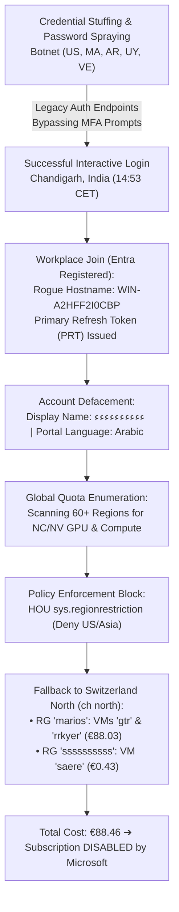
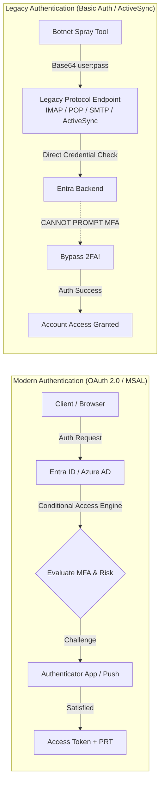
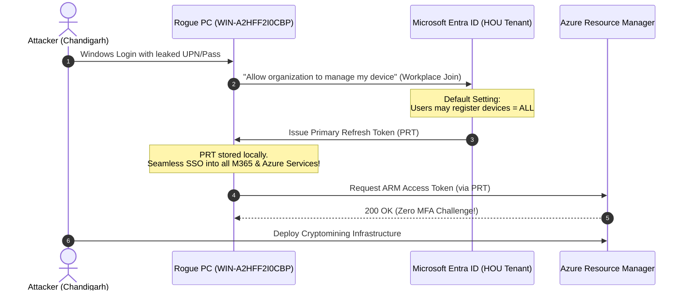

<Stats panicLevel={88} freddos={19} redbulls={5} hoursSpent={8} illegalActs={46} />

<Callout type="danger" title="The Great Student Cloud Credit Feast">
When cyberattackers target academic email addresses (`@ac.eap.gr`), they aren't hunting for your Java notes, digital logic homework, or algorithms assignments. They are hunting for the golden ticket: **the $100 free cloud credits of Azure for Students**. With these credits, automated botnets spin up high-compute virtual machines for Monero mining, password cracking, or bulletproof proxy exit nodes — leaving behind a crippled subscription, Arabic defacements, and a student frantically filing incident reports with their university Helpdesk.
</Callout>

Two weeks ago, I naively assumed I had witnessed the absolute limit of cyber-surrealism.

I had just published a comprehensive [forensic audit on Perplexity](/en/blog/perplexity-account-takeover-2500-euro-rag-audit): detailing how a session cookie stolen by a rogue extension ([WebCRX](/en/blog/rogue-browser-extension-incident-response)) drained €2,500 in pending credit card authorizations, how an attacker named "Pipo" executed an OAuth pivot into my 47 private GitHub repositories, and how he spun up automated clusters to generate 4.98 accumulator bets on second-division Turkish football.

*"All right,"* I thought. *"We cleaned house. We rotated master passwords, revoked sessions, flushed cookies, and hardened our browser profiles. Moving on."*

And right on cue, reality knocked on the door.

I casually logged into the **Microsoft Azure Portal** of Hellenic Open University (HOU / ΕΑΠ) using my academic UPN (`std******@ac.eap.gr`) to spin up a quick test lab.

And I walked straight into complete and utter mayhem.

---

## 1. The First Shock: Arabic and "Status: Disabled"

The first thing you see in a hijacked Azure tenant isn't a hacker terminal matrix. It's a surreal visual gut punch:

1. **My Display Name:** Completely overwritten with a string of Arabic characters:  
   `ءءءءءءءءءء`
2. **Portal & Webmail Language:** Full Arabic (Right-to-Left layout, navigation docked to the right, buttons and menus entirely in Arabic).
3. **The "Azure for Students" Subscription:** State: **`Disabled`** with a prominent red banner.
4. **Current Cost:** **€88.46** (with an automated billing projection rocketing to **€352.03** had Microsoft's automatic $100 spending cap not slammed the brakes).



For those unfamiliar with Microsoft's academic offerings: *Azure for Students* grants exactly $100 (roughly ~€92 at current exchange rates) in cloud credits without requiring a credit card. The second the botnet burned through €88.46 in under 24 hours, Microsoft's automated billing tripwire kicked in and flipped the subscription state to `Disabled`.

Had this been a standard Pay-As-You-Go subscription linked to a credit card, the invoice would have reached €350 by sunset and well over €2,000 by Sunday morning.

---

## 2. The Cardinal Sin: Why Legacy Authentication Bypasses Even the Best MFA

Here is the central question that keeps security architects awake at night:  
*“If I had Multi-Factor Authentication (MFA) enabled with Microsoft Authenticator on my phone, how on earth did a botnet spray credentials and successfully take over the account?”*

The answer is every Identity Architect's recurring nightmare: **Legacy Authentication**.



### Modern vs Legacy Authentication: A 20-Year-Old Loophole

In **Modern Authentication** (OAuth 2.0, SAML, MSAL):
* The client application never handles your raw password directly.
* Authentication takes place through an interactive webview or browser redirect.
* The **Conditional Access Engine** inside Microsoft Entra ID intercepts the flow: *“Wait a second. New IP address? Prompt for Number Matching in the mobile app immediately.”*

In **Legacy Authentication** (Basic Auth):
* Old protocols such as **Exchange ActiveSync, POP3, IMAP4, MAPI over HTTP, and Authenticated SMTP**.
* The client simply sends an HTTP header: `Authorization: Basic dXNlcjpwYXNz`.
* **These protocols were designed 20 to 30 years ago.** They are completely oblivious to interactive MFA prompts, number matching, or push notifications.
* If the organization (in this case, the university) has not configured an explicit Conditional Access policy to **unconditionally block Legacy Authentication**, Entra ID merely verifies whether `username + password` match. If they match, **it authenticates the session, completely bypassing MFA**!

### The "University Dilemma" of Academic IT Departments

Why do university Network Operations Centers (NOCs) still leave Legacy Authentication alive?
1. **The "Professor with Outlook 2010" Syndrome:** If administrators disable Basic Auth tenant-wide, support phones blow up with complaints from faculty members running decade-old email clients, ancient Thunderbird configs, or smartphones that don't support OAuth 2.0.
2. **Ancient Automation Scripts:** Decades-old cron jobs, bash scripts, and grade notifications relying on plain SMTP authentication.
3. **Fear of Operational Disruption:** Modernization requires tenant auditing, client upgrades, and enforcing Security Defaults — processes that move at a glacial bureaucratic pace in academia.

This is precisely the gap global botnets exploit. When an academic UPN (`std******@ac.eap.gr`) and a reused password surface in an infostealer dump, automated bots don't hit the main browser portal where MFA triggers. They relentlessly hammer the **Exchange Online endpoints** via password spraying.

---

## 3. The Smoking Gun: Ghost Machine `WIN-A2HFF2I0CBP` and the PRT

My first forensic move: navigate to **Microsoft Entra ID (formerly Azure AD)** and open the registered devices inventory (`Devices`).

My primary workstation, where I write code and study daily, is named **`Chris-Main`**.

What did I find registered as the sole device on the academic account?

* **Device Name:** `WIN-A2HFF2I0CBP`
* **Device Object ID:** `9c429a41-8731-45b6-af79-55ffa1264df5`
* **Join Type:** Microsoft Entra registered (Workplace Joined)
* **OS:** Windows 10/11
* **Status:** Inactive since 1 month prior



### How the Workplace Join Trap Operates

When you log into a Windows workstation using a school or work account, Windows displays a familiar dialog:  
*“Stay signed in to all your apps — Allow my organization to manage my device.”*

If confirmed, the operating system triggers a **Workplace Join (Entra Registration)**:
1. The machine generates a cryptographic key pair (bound to TPM or software container).
2. It registers the public key with the university's Entra ID tenant.
3. Entra ID issues a **Primary Refresh Token (PRT)**.
4. The PRT has a baseline validity of **14 days**, automatically refreshing with use up to **90 days**!

The fatal flaw? In default Entra ID tenant settings:  
`Entra ID -> Devices -> Device Settings -> Users may register their devices with Microsoft Entra = ALL`.

This means **any malicious actor with compromised credentials can turn their rogue laptop in Chandigarh into an officially "registered device" of the university**! From that moment onward, Entra ID regards the machine as an authenticated session, granting seamless Single Sign-On (SSO) into all cloud portals without ever re-prompting for passwords or MFA!

---

## 4. The Global Botnet: From Casablanca to Chandigarh

Opening the **Sign-in Logs** (under *User Sign-ins (interactive)* and *User Sign-ins (non-interactive)*) revealed the full scale of the operation.

This was not a lone hacker clicking around. It was a **distributed, automated botnet** executing continuous password spraying and credential stuffing across diverse protocols:

<ComparisonTable 
  headers={["Time (CET)", "Location", "Client App / Protocol", "IP / Range", "Result"]}
  rows={[
    ["13:15:51", "Montevideo, UY", "Microsoft Azure CLI", "Dynamic Residential", "❌ Failure"],
    ["13:15:53", "Rabat, MA", "Microsoft Azure CLI", "Maroc Telecom Dynamic", "❌ Failure"],
    ["13:36:43", "Buenos Aires, AR", "Microsoft Azure CLI", "Telecom Argentina", "❌ Failure"],
    ["14:53:44", "Chandigarh, IN", "Azure Portal (Browser via PRT)", "Targeted Dedicated IP", "🚨 SUCCESS (Compromise)"],
    ["15:08:37", "N. Carolina, US", "Microsoft Azure CLI", "Data Center Proxy", "❌ Failure"],
    ["16:21:05", "Casablanca, MA", "Azure AD PowerShell", "196.115.5.12", "❌ Failure"],
    ["16:39:02", "California, US", "Exchange Online (Legacy Auth)", "136.176.223.117", "❌ Failure"],
    ["17:02:47", "Massachusetts, US", "OfficeHome (Basic Auth)", "73.68.54.224", "❌ Failure"],
    ["17:39:43", "Virginia, US", "Exchange Online (Legacy Auth)", "3.81.71.139 (AWS EC2)", "❌ Failure (Post-Reset)"]
  ]}
/>

### Anatomy of the Compromised Sign-in Event

Isolating the raw JSON record of the successful login reveals the complete trail:

```json
{
  "id": "a4f89d12-612b-48cd-b829-192837465abc",
  "createdDateTime": "2026-11-11T14:53:44Z",
  "userPrincipalName": "std******@ac.eap.gr",
  "appDisplayName": "Azure Portal",
  "appId": "c44b3278-e5b3-472a-bc96-85847e6e7b83",
  "ipAddress": "103.xxx.xxx.xxx",
  "location": {
    "city": "Chandigarh",
    "state": "Punjab",
    "countryOrRegion": "IN"
  },
  "clientAppUsed": "Browser",
  "deviceDetail": {
    "deviceId": "9c429a41-8731-45b6-af79-55ffa1264df5",
    "displayName": "WIN-A2HFF2I0CBP",
    "operatingSystem": "Windows 10",
    "trustType": "Workplace"
  },
  "status": {
    "errorCode": 0,
    "failureReason": "Success"
  },
  "authenticationRequirement": "multiFactorAuthentication",
  "appliedConditionalAccessPolicies": []
}
```

### The Anatomy of Nothingness: Zero Trust Void (`"appliedConditionalAccessPolicies": []`)

Inspect the last two lines of the JSON payload closely. There lies the crux of modern academic cybersecurity failures:

```json
"authenticationRequirement": "multiFactorAuthentication",
"appliedConditionalAccessPolicies": []
```

This pair of values represents a **glaring architectural paradox**.

On one hand, Entra ID states that the authentication requirement was `multiFactorAuthentication`. On the other hand, the list of applied Conditional Access policies (`appliedConditionalAccessPolicies`) is **an empty array: `[]`**.

How can an account be marked as "MFA protected" on paper, yet have **zero security policies evaluated** when an unknown adversary logs in from Chandigarh, India into the Azure Portal?

#### 1. The Trap of Legacy "Per-User MFA" vs Conditional Access
In the Microsoft 365 identity ecosystem, two distinct management eras exist:
* **Legacy Per-User MFA (The Bronze Age):** The ancient admin portal (`account.activedirectory.windowsazure.com`) where an administrator toggled a checkbox next to a username ("Enforced / Enabled"). This mechanism is completely blind. It ignores device health, geographic origin, and session risk — and most crucially, **it is silently satisfied by an existing PRT issued via Workplace Join**.
* **Conditional Access (Zero Trust):** The modern policy engine of Entra ID. It evaluates real-time signals (Sign-in Risk, User Risk, Device Compliance, IP Geolocation, Client App) and enforces dynamic outcomes: *Allow? Require Phishing-Resistant MFA? Or Block access entirely?*

An empty `appliedConditionalAccessPolicies` array means **the tenant had zero active Conditional Access policies governing this scenario**. The institution relied entirely on legacy per-user flags, which remained dormant because the rogue machine was already registered!

#### 2. Impossible Travel: From Greece to Punjab in Zero Seconds
A student enrolled in a Greek university, authenticating daily from Greek or European IPs, suddenly initiates an interactive session from an ISP in Chandigarh, Punjab, India.
* **What Should Have Happened:** **Entra ID Identity Protection** incorporates machine learning detectors for **Atypical Travel (Impossible Travel)** and **Unfamiliar Sign-in Properties**. The engine calculates that traveling between Europe and India in minutes is physically impossible — unless you are strapped to an SR-72 hypersonic scramjet at Mach 6, a prototype Darkstar at Mach 10, or hitched a ride on a suborbital SpaceX Starship hop. The sign-in should have been tagged **High Risk** and instantly **Blocked** or challenged with hardware security keys.
* **What Actually Happened:** Because no Conditional Access policy mapped *High Sign-in Risk* to access denial, the login passed through without friction.

#### 3. Equating Webmail with Datacenter Cloud Management
The biggest flaw in academic cloud administration is **treating all applications with uniform leniency**.

To the university's tenant, a student checking syllabus announcements in Outlook Webmail carried the **exact same security requirement** as authenticating to **Azure Management (Portal / ARM REST API / PowerShell)** and deploying 60 virtual machines with public IP addresses!

In a sound cloud architecture, the Azure Management App (`c44b3278-e5b3-472a-bc96-85847e6e7b83`) is isolated by strict guardrails:
* Mandatory **Compliant Device** status (enrolled in Intune with active BitLocker and EDR).
* Strict **Geoblocking** (Greece, Cyprus, and verified EU regions only).
* **Continuous Access Evaluation (CAE)** to immediately terminate sessions if the IP changes mid-flight.

Instead, the attacker in Chandigarh enjoyed the exact same cloud management privileges as if they were sitting in a computer lab on the Patras campus.

---

## 5. Quota Reconnaissance: The 400KB CSV & The Wall of `sys.regionrestriction`

Examining the Resource Manager Activity Logs and download history exposed a massive reconnaissance export: **Compute Limits & Quotas across 60+ global Azure regions**.

When botnets compromise an Azure subscription, they don't guess blindly. They trigger an automated enumeration script against the ARM REST API:
* *“How many Standard_NC6 (Tesla GPU) cores will this subscription allow in East US?”*
* *“What is our Fsv2 (Compute Optimized) core quota in Germany?”*
* *“Can we provision 1TB Premium SSD LRS disks without tripping subscription limits?”*

The automated probe scanned every major datacenter: `eastus`, `southeastasia`, `australiaeast`, and beyond.

### The Saving Grace: `sys.regionrestriction`

And here came the plot twist.

The attacker attempted to deploy heavy compute clusters in US and Asian regions (where compute pricing is cheapest), but ran straight into **HTTP 403 / RequestDisallowedByPolicy errors**!

The IT/NOC of Hellenic Open University — credit where credit is due — had assigned an Azure Policy at the Management Group / Subscription scope:

```json
{
  "policyAssignmentName": "sys.regionrestriction",
  "policyDefinitionName": "Allowed locations",
  "parameters": {
    "listOfAllowedLocations": {
      "value": [
        "swedencentral",
        "norwayeast", 
        "francecentral", 
        "spaincentral", 
        "switzerlandnorth"
      ]
    }
  }
}
```

Only 5 European regions were permitted to provision resources!

The adversary, seeing policy denial errors flooding their console, adapted within seconds. They parsed the error message, extracted the whitelist, and headed straight for the **Swiss Alps (`switzerlandnorth`)**!

---

## 6. The Forensic Breakdown: Where Did the €88.46 Go?

A deep drill-down into the Azure Cost Management API and Resource Graph exposed the attacker's clandestine infrastructure spun up in hours:

<ComparisonTable 
  headers={["Resource Group", "Resource Name", "Resource Type", "Region", "Cost"]}
  rows={[
    ["marios", "gtr", "Virtual Machine (CPU Compute)", "Switzerland North", "€50.96"],
    ["marios", "gtr_osdisk_1_ea1ed...", "Managed OS Disk (Premium SSD)", "Switzerland North", "€25.84"],
    ["marios", "rrkyer", "Virtual Machine (Worker Node)", "Switzerland North", "€9.15"],
    ["marios", "rrkyer_osdisk_1_...", "Managed OS Disk (Standard SSD)", "Switzerland North", "€1.16"],
    ["marios", "gtr-ip / rrkyer-ip", "Public IP Addresses (IPv4)", "Switzerland North", "€0.93"],
    ["ssssssssss", "saere", "Virtual Machine (Worker Node)", "Switzerland North", "€0.38"],
    ["ssssssssss", "saere_osdisk_1_...", "Managed OS Disk (Standard SSD)", "Switzerland North", "€0.05"],
    ["ssssssssss", "saere-ip", "Public IP Address (IPv4)", "Switzerland North", "<€0.01"]
  ]}
/>

**Total: Exactly €88.46.**

### The Psychology of Naming: `marios` vs `ssssssssss`

The naming scheme of these Resource Groups is a textbook study in attacker behavior:
1. **`marios`:** Perfect social engineering camouflage. If a Greek sysadmin glanced at the portal, they might easily assume: *“Oh, Marios from 3rd semester is probably running a distributed systems lab.”*
2. **`ssssssssss`:** When the automation script races against detection thresholds, the attacker doesn't bother generating unique strings — they simply mash the `s` key into the input buffer.

Both resource groups were provisioned with Public IPs, open inbound ports, and CPU cores pegged at 100% running cryptomining payloads until Microsoft's automated credit ceiling pulled the plug.

---

## 7. Incident Response & Nuke: The 45-Minute Remediation

Within 45 minutes of discovery, full containment and eradication procedures were executed:

### Step 1: Resource Group Purge

Through Azure Cloud Shell (after toggling the portal language back from Arabic to English so I could see what I was clicking):

```bash
# Immediately delete malicious resource groups
az group delete --name marios --yes --no-wait
az group delete --name ssssssssss --yes --no-wait

# Verify no orphaned managed disks or public IPs remain
az resource list --query "[?resourceGroup=='marios' || resourceGroup=='ssssssssss']" -o table
```

### Step 2: Rogue Device Deletion in Entra ID

Via `myaccount.microsoft.com/device-list` and Microsoft Graph PowerShell:

```powershell
# Identify and disable the rogue device
$RogueDeviceId = "9c429a41-8731-45b6-af79-55ffa1264df5"
Update-MgDevice -DeviceId $RogueDeviceId -AccountEnabled:$false

# Permanently remove the device to invalidate the PRT
Remove-MgDevice -DeviceId $RogueDeviceId
```

### Step 3: Global Session Revocation

```powershell
# Invalidate all active Refresh Tokens and browser sessions worldwide
Revoke-MgUserSignOutEverywhere -UserId "std******@ac.eap.gr"
```
*Outcome: All active sessions held by the botnet in Chandigarh and proxy nodes across Morocco were terminated within seconds.*

### Step 4: Credential Rotation & Recovery Audit

* Master password rotated to a fresh 48-character passphrase.
* Security Info methods audited at `aka.ms/mfasetup`.
* Verified that the sole recovery phone number remained my German mobile (`+49...`) and the sole MFA method was the Microsoft Authenticator app on my phone.
* Restored the account Display Name from `ءءءءءءءءءء` back to my legal name.

---

## 8. Blueprint for the University NOC: 5 Hardening Rules (And Why the Year 2000 Is Over)

<Callout type="warning" title="The False Sense of Security in Academic IT: Trapped in the Year 2000">
In many Greek academic institutions, cybersecurity is still viewed through a 2000s mindset: *“We have a hardware firewall at our perimeter, a domain controller in the basement, and anyone with a username and password is one of us.”*

In 2026, **that mindset is architectural suicide**. The network perimeter is dead. Over 45,000 student and faculty identities are directly exposed to the internet via the cloud edge (`login.microsoftonline.com`). Leaving default tenant configurations untouched is not just technical neglect — it is a systemic hazard to the personal data of tens of thousands of citizens.
</Callout>

### The Chronicle of Foretold Negligence: From the 2024 813GB Ransomware to the 2026 Botnet

The most infuriating aspect of this incident is not the botnet itself. It is that **the previous disaster failed to teach the institution anything**.

For those with short memories: On **October 25, 2024**, Hellenic Open University suffered a [catastrophic ransomware attack](https://www.dikastiko.gr/category/eidhsh/epithesh-chaker-sto-ellhniko-anoichto-panepisthmio-dierreysan-pano-apo-813-gb-me-oikonomika-kai-prosopika-dedomena/). Attackers compromised privileged credentials, gained access to core infrastructure and backup systems, encrypted the virtualization hypervisors, and leaked **over 813 Gigabytes** of sensitive data onto the Dark Web:
* Tax numbers (AFM), Social Security numbers (AMKA), Police IDs, physical signatures, and photos.
* Financial records (IBANs, invoicing details, payment warrants).
* Academic records (transcripts, degree certificates, grading sheets).
* Even **sensitive student and staff health records**!

And what was the university's official communication in its March 2025 announcement? Two unforgettable quotes that should be taught in PR failure courses:
1. *“The volume of leaked data stands at 813GB... representing an extremely small percentage... comparable to the storage capacity of a typical laptop hard drive!”* (Translation: *“Relax, it's just a single laptop hard drive filled with your tax IDs and medical history.”*)
2. *“The leaked archive is located on the dark web, where access requires specialized, technical knowledge”* (As if downloading Tor Browser requires a postdoctoral degree in theoretical physics).

At the time, the university publicly promised:  
> *“Targeted measures have already been deployed to strengthen IT systems security, alongside an ongoing comprehensive infrastructure upgrade incorporating additional security safeguards.”*

**Fast-forward to today.**  
Where were those "additional security safeguards" in Cloud Identity?
* Legacy Authentication remained wide open to password spraying.
* Device Registration remained on default `ALL`, allowing anyone to register rogue Windows machines from India.
* Applied Conditional Access policies were literally **zero (`[]`)**.
* And Impossible Travel detectors failed to blink when a user teleported from Greece to Chandigarh in minutes.

If an 813 GB dark web leak and a crippled datacenter didn't motivate the implementation of basic Conditional Access for geoblocking and legacy auth, one must ask: **what disaster will it take for identity security to be taken seriously?**

### The 5 Non-Negotiable Hardening Policies

If you are a Network Admin, CISO, or Identity Engineer in an educational institution, here are the 5 policies to implement immediately:

### 1. Unconditional Block on Legacy Auth (CAP01) — Bury Basic Auth
Microsoft began deprecating Basic Auth in Exchange Online back in **2019** and finalized it in 2022. Leaving legacy protocols active in 2026 is inexcusable.
* **Target:** All Users -> Cloud Apps: All Cloud Apps.
* **Conditions -> Client apps:** Check *Exchange ActiveSync clients* and *Other clients*.
* **Grant:** **Block access**.
* *Result:* Botnets can no longer bypass MFA via IMAP, POP3, or legacy Exchange spraying.

### 2. Lock Down Device Registration (Workplace Join)
Allowing arbitrary machines to register and harvest Primary Refresh Tokens is identity suicide.
* **Setting:** `Microsoft Entra ID -> Devices -> Device Settings`.
* Change `Users may register their devices with Microsoft Entra` from **ALL** to **Selected**, or enforce mandatory MFA during registration.
* Better yet: Require **Device Compliance (Intune / Defender for Endpoint)** before issuing PRTs.

### 3. Geoblocking & Named Locations on the Azure Management Plane
No Greek university student needs to manage the Azure Portal or execute `Azure CLI` commands from Chandigarh, Nigeria, Russia, or Argentina.
* **Target:** Cloud App: **Microsoft Azure Management** (`c44b3278-e5b3-472a-bc96-85847e6e7b83`).
* **Conditions -> Locations:** Configure Named Locations for Greece, Cyprus, and verified EU regions.
* **Grant:** **Block access** for all other geographies. Exceptional foreign travel can be handled via Helpdesk tickets. The security of 45,000 accounts takes priority over convenience.

### 4. Enforce Number Matching & Phishing-Resistant MFA — Kill Simple Push
Simple tap-to-approve push notifications are dead. Adversaries spam push requests at 3:00 AM until exhausted users hit "Approve" (MFA Fatigue).
* Enforce **Number Matching** in Microsoft Authenticator.
* Enable **Additional Context** (displaying the application name and geographic location on the prompt).
* Provide **FIDO2 Security Key** options for faculty and administrative staff.

### 5. Restrict Directory Permissions & Automate Budget Kill-Switches
Don't leave your tenant directory wide open to scraping:
* **Directory Scoping:** `Entra ID -> User Settings -> Restrict access to Microsoft Entra administration portal = YES`. Enable `Restrict non-admin users from reading other users' data` to prevent directory harvesting.
* **Azure Budget Kill-Switch:** On *Azure for Students* subscriptions, configure an automated **Budget Alert at €5** with email notification at 50% (€2.50).
* **Automated Runbook:** Wire an Azure Action Group to an Automation Runbook that automatically deallocates running VMs when the budget threshold is crossed.

---

## 9. Blue Team Takeaways

For students, developers, and cloud administrators alike, keep these 4 core takeaways in mind:

1. **Cloud Credits Are Hard Currency:**  
   Never dismiss "free" academic or developer credits. To organized botnets, $100 in Azure compute isn't a learning allowance — it's free password cracking, Monero mining, and anonymous attack infrastructure.
2. **Check Your Registered Devices NOW:**  
   Visit [myaccount.microsoft.com/device-list](https://myaccount.microsoft.com/device-list). If you spot any unrecognized machines like `WIN-XXXXX`, disable and delete them immediately. That "Allow my organization to manage my device" prompt is a direct backdoor for Primary Refresh Tokens.
3. **Legacy Auth Renders Your MFA Useless:**  
   You may sleep soundly thinking Microsoft Authenticator protects you. But if your organization permits Basic Auth on legacy protocols, your MFA is merely decorative.
4. **Defense in Depth: The Single Policy That Saved the Day:**  
   The sole factor that stopped this incident from generating a €2,000 bill in an afternoon was the Azure Policy `sys.regionrestriction`. Even when all identity perimeters failed, an infrastructure constraint contained the damage and forced the attackers into 5 regions.

---

## 10. Sotiria Answers: From Incident to Defense Engine

Just as in the aftermath of the Perplexity breach ([INC-2026-PX01](/en/blog/perplexity-account-takeover-2500-euro-rag-audit)), this incident was immediately translated into defensive modules for the open-source endpoint shield **Sotiria**:

<ComparisonTable 
  headers={["Threat Vector", "Sotiria Detection Engine", "Defensive Hardening"]}
  rows={[
    ["Workplace Join Persistence (WIN-A2HFF2I0CBP)", "Module 11 (Entra Device & PRT Guard)", "Detects and alerts when a new device registers against the Cloud Identity outside approved hardware hashes"],
    ["Primary Refresh Token (PRT) Abuse", "Module 11.2 (Token Binding & SSO Monitor)", "Monitors the AAD WAM broker for anomalous token requests originating from non-whitelisted processes"],
    ["Password Spraying on Legacy Protocols", "Module 9.4 (Auth Protocol Auditor)", "Audits local Outlook/Mail accounts to enforce Modern Auth (OAuth 2.0) and alert on Basic Auth channels"],
    ["Rogue Compute Provisioning (gtr / rrkyer)", "Module 12 (Cloud Telemetry / Cost Guard)", "Integrates with Azure Resource Graph API for real-time alerting whenever VMs spawn in unexpected regions"]
  ]}
/>

---

## 11. Grand Finale: Trilogy? More Like the Next Star Trek (And the Terror of the Multiverse)

Reviewing the timeline over recent weeks, the narrative theoretically seems to complete a "trilogy."

Yet let's be entirely honest with ourselves: **given the operational shambles inside the university's IT, this isn't a trilogy — it's the next Star Trek with infinite seasons and spin-offs.** My only genuine existential worry now is **preventing it from becoming a Marvel Multiverse**, where in some parallel timeline the university's NOC actually enables Conditional Access, the 813 GB turns into 813 Petabytes, and Pipo gets appointed Chief Cybersecurity Officer at the Ministry of Education:

* **Season 1 ([WebCRX](/en/blog/rogue-browser-extension-incident-response)):** An "innocent" Chromium extension resides 71 days on the system, communicates with C2 endpoints via HTTP/3 QUIC, and siphons session cookies.
* **Season 2 ([Perplexity & Pipo](/en/blog/perplexity-account-takeover-2500-euro-rag-audit)):** The stolen cookie pivots into Perplexity, upgrades to MAX Annual, drains €2,500 in API auto-refills, unlocks 47 private GitHub repositories, and predicts second-division Turkish football matches.
* **Season 3 (The Azure Circus):** The leaked UPN feeds a global botnet, sprays legacy endpoints, registers a ghost PC, renames me to `ءءءءءءءءءء`, flips the portal to Arabic, and sets up a cryptomining farm in the Swiss Alps under Resource Group `marios`!

<Callout type="info" title="The Surreal Reality of an Engineering Student">
I was sitting in Germany, sipping an iced Freddo Espresso, trying to solve Linear Algebra exercises for **PLI12** just to scrape a passing 5/10 in my exams.

And I ended up:
1. Threat hunting in real time across botnet proxy pools in Punjab and Morocco.
2. Deciphering Right-to-Left Arabic portal menus just to locate the *Delete Resource Group* button.
3. Drafting technical security advisories for a university NOC that, after losing 813 GB to the Dark Web, still insists the dark web requires "rocket science" and that 813 GB of citizen data is "just a typical laptop hard drive."
</Callout>

If there is one definitive conclusion to draw from this entire saga, it is this:

**In cybersecurity, there is no such thing as "I am just a student" or "we are just a university."**  
To the automated scripts scouring the internet every millisecond, you are not Christos cramming for exam season. You are $100 in unspent cloud compute, you are a Primary Refresh Token waiting to be harvested, and you are an unmonitored legacy port waiting for someone to push it open.

Shut down Legacy Auth, purge the ghost devices from your tenant, configure budget alerts at €5...

...and if you ever spot a Virtual Machine named **`gtr`** running in **`ch north`** inside your Azure subscription, pull the plug immediately before a wormhole opens in space-time.

*Live long, prosper, disable Legacy Auth, and keep your Alps clean.*

