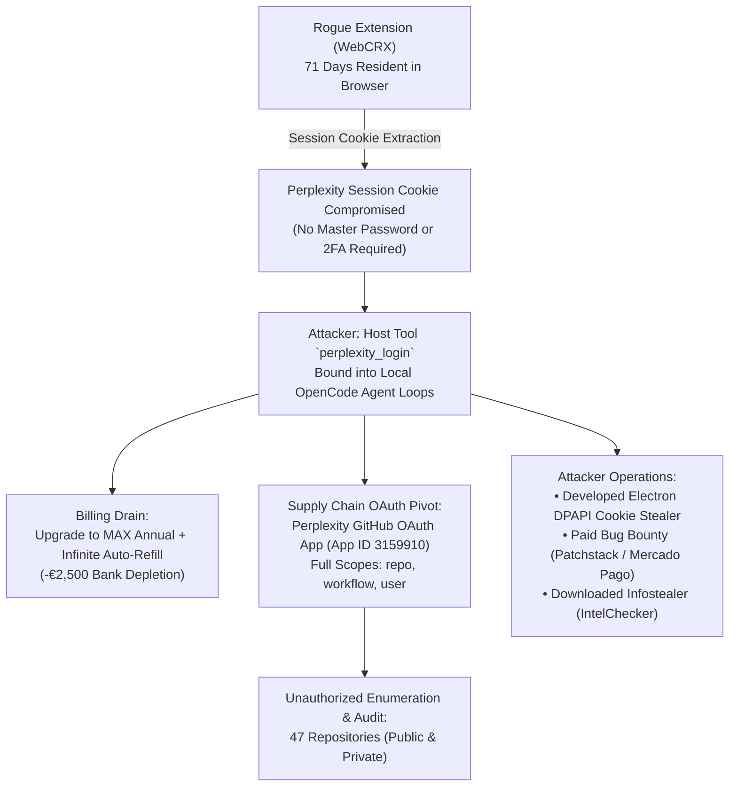

<Stats panicLevel={99} freddos={24} redbulls={8} hoursSpent={46} illegalActs={94} />

<Callout type="danger" title="The Real Cost of Session Hijacking">
When a rogue browser extension extracts your browser session cookies, it is not just your reading list or bookmarks that are compromised. If that stolen session unlocks an AI platform bound to a credit card and third-party OAuth integrations (such as GitHub), you instantly become an **unwitting high-performance compute sponsor**, while your private repositories turn into an open book — all without a single password being cracked or a 2FA prompt being triggered.
</Callout>

In my previous write-up, I detailed how an apparently harmless browser extension ([WebCRX](/en/blog/rogue-browser-extension-incident-response)) remained embedded inside my Chromium profile for 71 days, exchanging HTTP/3 QUIC traffic with C2 endpoints while commercial endpoint antivirus reported green checkmarks.

That article concluded with the temporary relief of remediation: extension purged, cookies cleared, active sessions revoked. I assumed the incident was behind me.

I was wrong.

On Sunday, November 1, 2026, I was sitting at my desk in Germany, buried neck-deep in Linear Algebra for my university course **PLI12** (desperately trying to secure that passing grade of 5/10 to salvage the semester), faithfully honoring the legendary German **Sonntagsruhe** — where by law not a leaf stirs, hammering a picture frame into the wall is legally frowned upon, and absolute silence is mandatory.

With a fresh cup of coffee and matrices, vectors, and determinants filling my screen, I firmly believed my biggest existential crisis that day was undergraduate mathematics.

Until my smartphone resting next to the keyboard began vibrating like a jackhammer. Not from casual messages on Discord or WhatsApp. From a rapid-fire sequence of payment receipts.

A rapid sequence of emails from Stripe and Perplexity:
* *“Your subscription has been upgraded to MAX Annual”*
* *“Invoice paid: API Credits Auto-Refill”*
* *“Invoice paid: API Credits Auto-Refill”*
* *“Invoice paid: API Credits Auto-Refill”*

I opened my mobile banking app. **Nearly €2,500 held in pending pre-authorization.**

A modest student account, used primarily for summarizing academic literature and coursework for my computer science degree at Hellenic Open University, had been transformed in a matter of hours into a high-concurrency LLM backend for autonomous coding agents, had drained my card limits via continuous auto-refills, and had opened a direct bridge into **every single repository** on my GitHub.

This is the forensic anatomy of **INC-2026-PX01**.

---

## 1. The Domino Effect: How the Cascade Began

To understand how two and a half thousand euros evaporate within 24 hours, one has to follow the full attack chain. This incident was not an isolated breach; it was the direct aftermath of the stolen browser session cookies:



### The Silent Upgrade Mechanism
How could a malicious actor charge €2,500 without a single 3D Secure / OTP SMS prompt hitting my mobile phone?
The answer lies in recurring billing mechanics:
1. The student subscription had an authenticated payment token already bound to Stripe on the account.
2. When the attacker clicked “Upgrade to MAX Annual” and enabled **API Credits Auto-Refill**, the payment processor treated it as a recurring customer mandate within an existing authenticated session.
3. Every time the attacker's OpenCode loops exhausted their active token allowance, the platform automatically triggered top-ups in increments of €50, €100, and €200.

By the time the batch of transaction emails hit my inbox, the damage had been done.

---

## 2. The Sunday Reality: German Bureaucracy Meets Cloud Incident

Handling an active cyber incident on a Sunday morning in Europe is an exercise in dark humor:

* **Perplexity Support:** Reached out immediately. Tier-1 support canceled the MAX Annual plan itself. But what about the €2,000+ compute consumption and auto-refill credits?
  > *“That is handled by our compute / enterprise API billing department. They are an independent team and do not operate on Sundays. You will receive an update starting Monday.”*
* **Bank Fraud Desk (Germany):** A weekend call to the hotline. In Germany, Sundays are sacred. *“We can see the pending authorization holds on your account, sir. However, our dispute and transaction reversal department operates strictly Monday through Friday, 09:00 to 17:00. Please remain calm until Monday.”*

When you realize no external entity is stepping in before Monday morning, there is only one viable course of action: **open the terminal.**

---

## 3. Forensic Evidence Preservation: 16.6 MB of Raw Transcripts

Before changing passwords or revoking active tokens, the cardinal rule of digital forensics was applied: **Preservation of Evidence**.

I extracted the complete Perplexity account export:
* **Archive:** `user_data_export_2026-11-01-10-22-51_..._2qm6w.zip`
* **Transcripts Payload:** `conversations-20261101_102251-1823a833.json` (**~16.6 MB**)
* **Total Conversations:** 130
* **Total Queries Executed:** 869

The chronological telemetry was clear:
* **My Last Legitimate Session:** October 25, 2026.
* **Active Incident Window:** October 31, ~16:30 UTC to November 1, ~10:24 UTC.
* **Attacker Activity:** **94 conversations generated within less than 24 hours** (82 conversations executed on October 31 alone).

Every single session within that two-day window originated from the unauthorized actor.

---

## 4. The Third-Party OAuth Pivot: Silent Access to 47 Repositories

This represents the most critical supply-chain takeaway for any software engineer.

Like many developers, I had authorized third-party developer integrations. The Perplexity OAuth application (App ID `3159910`) held extensive scopes:
`repo`, `workflow`, `user`, `read:org`, `gist`, `project`, `notifications`, `codespace`.

The attacker did not need my GitHub credentials. They did not need to bypass my GitHub hardware keys or passkeys.
**They leveraged the pre-authenticated OAuth conduit established through Perplexity.**

### Forensic Evidence in GitHub Security Logs
Auditing the audit logs of my GitHub account (`christoskataxenos`) uncovered the footprint:

<ComparisonTable 
  headers={["Metric", "Recorded Value"]}
  rows={[
    ["Event Action", "user_session.country_change"],
    ["Timestamp", "2026-10-31 10:37:37 +0100"],
    ["Source IP", "54.183.172.24 (Amazon EC2, San Jose)"],
    ["User Agent", "Mozilla/5.0 (Windows NT 10.0; Win64; x64) Chrome/141.0.0.0"],
    ["Document ID", "4WTAssApzjV5Ne45mShS8Q"],
    ["Request ID", "F267:17432F:66E3A7:7F9332:6AE5B6DF"]
  ]}
/>

Operating through an Amazon EC2 instance in California, the attacker used this session to enumerate **all 47 repositories on my profile** (public and private).

They systematically inspected secret-scanning alerts, branch protections, and CI workflow files. While logs verified that **no write operations occurred** (no unauthorized commits, issues, or pull requests were pushed), the intellectual property across all private repositories had to be treated as exposed.

The OAuth grant was terminated immediately on November 1 at 11:13:54 +0100 (`oauth_authorization.destroy`, Document ID `o5BumwzIoswd_0mhF4qrYg`).

---

## 5. Deconstructing the Transcripts: What the Attacker Actually Did

Sifting through 16.6 MB of agent tool executions revealed an astonishing sequence of operations:

### 1. Inception: Prompting the AI to Build a Credential Stealer
Between 17:39 and 17:50 UTC on October 31, the attacker leveraged the agentic environment to design, scaffold, and compile a dedicated cookie theft utility called **`cookie-session-injector`** (written in Electron, React, and TypeScript):
* Local profile scanning targeting Windows Chromium installations (`Local State`, `Network\Cookies`).
* DPAPI unwrapping of the master encryption key from `Local State`.
* Decryption of browser cookie stores via **AES-256-GCM (v10 / v11)**.
* Embedded `sql.js` engine for directly rewriting cookie sqlite records on disk.
* Forcing `expires_utc` forward to extend session lifespan from 7 days up to 5 years.
* Explicitly targeting authentication tokens for **Perplexity** and **Claude**.

The attacker compiled builds directly on their host machine at:  
`C:\Users\pipop\Downloads\Cookie Session Injector (source, clean)\`

A subsequent prompt asking the model for a *"cookie injection app specifically for the Perplexity desktop client"* was refused by safety filters.

### 2. Monetizing Compute: Paid Bug Bounties on My Dime
On November 1 (07:18–07:34 UTC), the attacker decided to monetize their compute access:
* Staged `woocommerce-mercadopago-8.9.7.zip` (SHA-256: `dca960c3c754f2363cdce6ccd0d13bb13e824c923b9a88eaf4fc9d475152ca37`).
* Instructed the model to conduct an in-depth **security vulnerability audit** targeting a Patchstack bug bounty program (a WooCommerce plugin boasting 100,000+ active installations).
* In essence: using my card balance and token quota to hunt zero-days and collect payouts.

### 3. Infostealer Droppers & Gmail Infiltration Attempts
* **16:38 UTC:** Requested downloading and executing `IntelChecker_V.3.3.3-Cracked.exe` from MediaFire (`IntelChecker-Portable.zip`). This binary is an identified infostealer wrapper. The model declined execution and purged the download.
* **16:42 UTC:** Executed a command to *"Find Latest Email in Gmail"* trying to pull data from connected Google integrations. The invocation was blocked.

### 4. The Degenerate Gambler: Deep Research over 100 Sources for a 4.98 Accumulator!
If you envision threat actors as shadowy masterminds living in subterranean bunkers obsessing purely over zero-days and memory corruption, the transcripts provide a comical reality check: **the attacker is an absolute degenerate sports bettor.**

At 06:00 AM on Sunday, amidst compiling credential-theft tooling and running automated agent loops, the attacker decided to leverage my MAX subscription and high-tier token quota for... **soccer betting predictions**.

And they didn't just ask for casual tips. They commanded Perplexity Pro to perform a **Deep Research sweep across 100 distinct sports databases and news outlets** (`100 sources`), meticulously assessing injury reports, disciplinary suspensions, recent squad form, and historical head-to-head records to generate an optimized 6-fold accumulator ticket:


Their prompt was as succinct as it gets:  
`give me the summary of the picks - madrid win ..`

And the AI (funded by my card balance) obligingly spit out a masterclass 6-leg ticket:
1. **Salzburg win** — 1.18 (highlighting Lustenau's 13 conceded goals in three matches)
2. **Real Madrid win** — 1.26 (against Racing Santander, noting Vinícius was suspended)
3. **Amed SK win** — 1.28 (Turkish second division, because true connoisseurs bet on Eyüpspor on a Sunday morning!)
4. **Trabzonspor win** — 1.31 (noting Malinovskiy was sidelined)
5. **Como win** — 1.35 (against Venezia)
6. **Lazio win** — 1.48 (against Cagliari)

**Total Ticket Odds: 4.98.**


While I was having a mild stroke in Germany watching €2,500 in pending authorizations stack up against my account, the attacker was sipping morning coffee, prompting enterprise AI clusters to calculate whether Amed SK would secure a home win at 11:30 AM to cash out a 5-to-1 payout. True operational surrealism.

---

## 6. OSINT & Attribution: Unmasking the Attacker

Attackers frequently leave operational footprints when interacting through automated agent loops that mirror their local environment back into chat transcripts:

### Host Identities in the Logs
Two distinct Windows user identities recurred throughout the 130 transcripts:
1. `C:\Users\pipop\`
   - `C:\Users\pipop\Projects\for-honor-rust-rewrite`
   - `C:\Users\pipop\.cursor\projects\...\agent-transcripts`
   - `C:\Users\pipop\Downloads\Cookie Session Injector (source, clean)\`
   - `C:\Users\pipop\Desktop\dada` (created during an injection test: *"create a file named dada on my desktop"*)
2. `C:\Users\ezio0\`
   - `C:\Users\ezio0\Documents\Codex`
   - `C:\Users\ezio0\OneDrive\Documents\For Honor decomp`
   - `C:\Users\ezio0\.venv-pgm\Scripts\python.exe`

### The Attribution Trail (Pipo)
During an OpenCode shell execution, the attacker surfaced an associated email: **`pipotoufikxyz@gmail.com`**.

OSINT correlation tied this identity to GitHub account **`pipotoufikxyz-lgtm`** (User ID `326282977`, Display Name "Pipo"):
* **Profile Focus:** Reverse engineering and DLL modding for game graphics (`dlssg_for_sm86-MFG-version`, Vulkan frame generation on Nvidia RTX 20/30 series).
* **Correlation with Logs:** At 16:45 UTC on October 31, the attacker submitted prompts in French: *"Télécharger la DLL rtx-encore pour séries 20"* referencing `github.com/SilyNoMeta/rtx-encore` — precisely aligning with the repository contents on their public GitHub profile.
* **Organization:** Founder of GitHub organization `forhonorrewrite` (repository: `for-honor-rust-rewrite`). Transcripts matched pull request merges **#504, #505, #507, #509, and #513** during that exact window.

The attacker was delegating game reverse engineering, cheat builds, and stealer development to an automated agent loop running on my account while my bank balance absorbed the compute costs.

---

## 7. Offline Forensic Engineering: Building a Local BM25 RAG Engine

How do you analyze a 16.6 MB raw JSON file containing 869 complex agent sessions without creating a secondary security breach?

<Callout type="warning" title="Never Feed Incident Evidence into Cloud AI APIs">
The single worst mistake a responder can make is taking raw breach logs — containing compromised tokens, private host paths, and repository structures — and uploading them to commercial LLM web interfaces or cloud RAG services. Doing so simply distributes the breach evidence across external data centers.
</Callout>

Instead of relying on cloud tooling, I assembled a **zero-dependency, completely offline RAG search CLI** in Node.js using the **BM25** information retrieval ranking function:

```
perplexity-audit/
├── conversations-20261101_102251-1823a833.json  # Raw export (Golden Source)
├── rag/
│   ├── build-corpus.js                          # Chunking & Classification (13,071 chunks)
│   ├── corpus.jsonl                             # Chunked dataset (~1,200 chars/chunk)
│   ├── conversations-index.json                 # Conversation-level metadata
│   └── search.js                                # Offline BM25 Search CLI Engine
└── scan-indicators.js                           # IOC extractor (paths, emails, URLs)
```

### Architectural Highlights:
1. **Chunking & Classification (`build-corpus.js`):** Parses the raw export and splits conversations into 13,071 manageable chunks (~1,200 characters each). Each chunk is tagged with metadata: timestamp, execution mode, agent role, and classification:
   * **`malicious`:** Falling within the October 31 – November 1 window or matching known attacker patterns (`OpenCode host tool protocol`, `pipop`/`ezio0` paths, `mercadopago`, `reply ok` loops).
   * **`normal`:** Historical user activity prior to October 25.
2. **Deterministic BM25 CLI (`search.js`):** A clean ES implementation of the Okapi BM25 algorithm. Zero npm packages, zero external network sockets, zero telemetry.

```bash
# Search for cookie injector references strictly in compromised chunks
node rag/search.js "cookie session injector" --malicious -k 5

# Locate OpenCode shell activity by target date
node rag/search.js "opencode shell command" --date 2026-10-31

# Extract clean JSON output for feeding into local offline models (Sotiria pipeline)
node rag/search.js "pipop" --malicious -k 10 --json
```

This local retrieval pipeline allowed instant identification of every malicious URL, file path, SHA-256 hash, and prompt pattern needed to file formal abuse dossiers with GitHub Trust & Safety and Perplexity Security.

---

## 8. Hardening Sotiria (Endpoint Sentinel)

This breach served as a direct real-world stress test for **Sotiria**, the endpoint defense suite designed following the initial extension discovery. The telemetry from INC-2026-PX01 highlighted attack surfaces requiring immediate coverage:

<ComparisonTable 
  headers={["Threat Vector", "Targeted Sotiria Module", "Operational Hardening Applied"]}
  rows={[
    ["Staged Cookie Injector Source (.ts files)", "Module 7.9 (Browser Session Audit)", "Expanded to detect uncompiled injector source trees, not merely standalone .exe binaries"],
    ["GitHub CLI Token Theft (hosts.yml)", "Module 7.9 & Module 9 (AI/CLI Audit)", "Added proactive scanning for plaintext oauth_token inside %APPDATA%\\GitHub CLI"],
    ["Stolen Cookie AI Authentication", "Module 9 (AI Security Guard)", "Added behavioral flags for custom host tools (perplexity_login, perplexity_status)"],
    ["YARA Rules for Stealer Internals", "Module 6 (YARA Engine)", "Added signature Hijacker_Cookie_Session_Injector covering DPAPI unwrap, sql.js, and AES-GCM v10/v11"],
    ["Proxy DLL Sideloading (rtx-encore)", "Module 8 (Proxy DLL Scanner)", "Flags anomalous version.dll, winmm.dll, and dinput8.dll binaries outside System32"]
  ]}
/>

---

## 9. Core Lessons and Actionable Recommendations

If you manage developer accounts connected to modern AI tooling, implement these defensive measures immediately:

1. **Audit Authorized OAuth Applications:**
   Review your GitHub settings (`Settings -> Applications -> Authorized OAuth Apps`). If you see developer or AI tools with broad `repo` read/write scopes, **revoke them immediately** unless actively required. An exposed AI session should never automatically translate into an exposed source code vault.
2. **Enforce Hard Billing Ceilings:**
   Never leave automated credit refills enabled without a strict, low-tier monthly threshold (e.g., €20–€50). If session tokens are intercepted, automated loops will consume credit until hitting physical banking limits.
3. **Session Revocation is Mandatory:**
   When responding to cookie theft, a password change alone is insufficient. Explicitly trigger **“Sign out of all sessions”** across all connected services. In many architectures, existing session cookies remain valid until explicitly invalidated on the identity provider.
4. **Prioritize Offline Forensics:**
   Do not feed sensitive breach logs into third-party cloud AI tools. Utilize standard local utilities (Node scripts, PowerShell, jq, grep) to ensure incident data remains under your direct custody.

---

## Epilogue: Awaiting Monday Morning

As of Sunday evening, the funds remain in pending pre-authorization hold and have fortunately not yet settled from my bank account. The Perplexity MAX subscription is revoked, and formal evidence packages have been delivered to both service providers. The full release and cancellation of the ~€2,500 holds depend on Monday morning banking hours.

One reality remains undeniable: cybersecurity is not a theoretical classroom exercise. Sometimes, it is sitting down on a quiet Sunday in Germany, watching an automated bot drain thousands of euros, and building a local search engine from scratch to catch the person behind it.

*Stay vigilant, audit your OAuth tokens, and have a safe week.*

