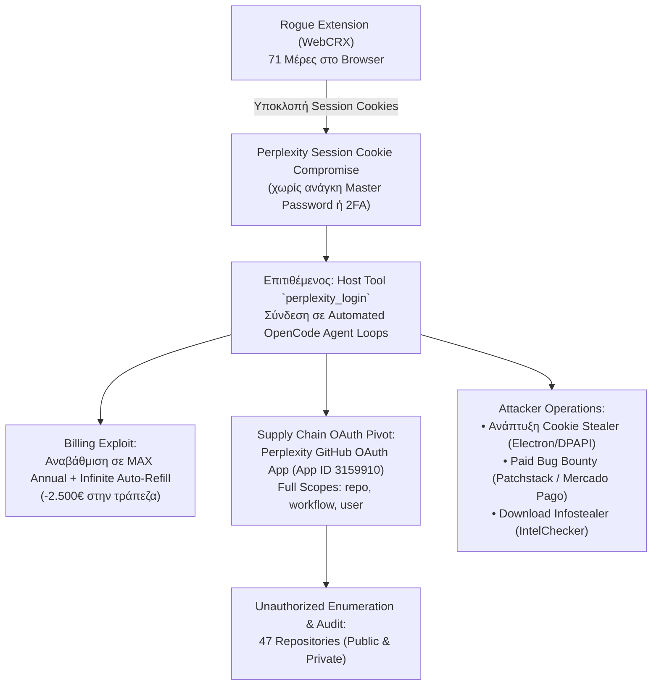

<Stats panicLevel={99} freddos={24} redbulls={8} hoursSpent={46} illegalActs={94} />

<Callout type="danger" title="Το Πραγματικό Κόστος ενός Session Hijacking">
Όταν ένα rogue browser extension υποκλέπτει τα session cookies σας, δεν κινδυνεύουν μόνο τα bookmarks ή το ιστορικό περιήγησης. Αν το cookie ξεκλειδώνει μια πλατφόρμα AI που έχει συνδεδεμένη πιστωτική κάρτα και 3rd-party OAuth integrations (όπως το GitHub), μετατρέπεστε αυτομάτως σε **χρηματοδότη υπολογιστικής ισχύος**, ενώ τα ιδιωτικά σας repositories γίνονται ανοιχτό βιβλίο — χωρίς να παραβιαστεί ούτε ένας κωδικός πρόσβασης και χωρίς να χτυπήσει κανένα 2FA prompt.
</Callout>

Στο προηγούμενο άρθρο περιέγραψα πώς ένα «αθώο» browser extension ([WebCRX](/blog/rogue-browser-extension-incident-response)) παρέμεινε κρυμμένο στον Chromium browser μου για 71 ημέρες, επικοινωνώντας μέσω HTTP/3 QUIC με C2 servers ενώ το antivirus κοιμόταν τον ύπνο του δικαίου. 

Εκείνο το άρθρο τελείωνε με την ανακούφιση του καθαρισμού: αφαίρεση extensions, καθαρισμός cache, revoke sessions. Θεώρησα ότι το κεφάλαιο έκλεισε.

Πόσο αφελής ήμουν. 

Την Κυριακή 1 Νοεμβρίου 2026, καθόμουν στο γραφείο μου στη Γερμανία, χωμένος μέχρι τα μπούνια στη Γραμμική Άλγεβρα της **ΠΛΗ12** (μπας και πάρουμε εκείνο το πολυπόθητο 5 στο τέλος και σωθεί το έτος), τιμώντας ευλαβικά τη θρυλική γερμανική **Sonntagsruhe** — όπου βάσει νόμου δεν κουνιέται φύλλο, απαγορεύεται μέχρι και να καρφώσεις κάδρο στον τοίχο, και η απόλυτη ησυχία είναι υποχρεωτική.

Είχα τον καφέ μου, διανύσματα, πίνακες και ορίζουσες στην οθόνη, πιστεύοντας ακράδαντα ότι το μεγαλύτερο μου υπαρξιακό δράμα εκείνη την ημέρα ήταν τα μαθηματικά του ΕΑΠ.

Μέχρι που το smartphone δίπλα στο πληκτρολόγιο άρχισε να δονείται σαν κομπρεσέρ. Όχι από μηνύματα στο Discord ή στο WhatsApp. Από μαζεμένες ειδοποιήσεις πληρωμών. 

Μαζεμένα emails από το Stripe και την Perplexity:
* *«Your subscription has been upgraded to MAX Annual»*
* *«Invoice paid: API Credits Auto-Refill»*
* *«Invoice paid: API Credits Auto-Refill»*
* *«Invoice paid: API Credits Auto-Refill»*

Ανοίγω την εφαρμογή της τράπεζας. **Σχεδόν 2.500€ σε εκκρεμή δέσμευση (pending authorization hold).** 

Ένα ταπεινό φοιτητικό account, που το είχα για να διαβάζω και να συνοψίζω σημειώσεις για το ΕΑΠ, είχε μετατραπεί μέσα σε λίγες ώρες σε high-performance LLM backend για automated coding agents, είχε εξαντλήσει τα όρια της κάρτας μου με απανωτά auto-refills, και είχε ανοίξει κερκόπορτα σε **όλα** τα repositories του GitHub μου.

Αυτή είναι η ανατομία του περιστατικού **INC-2026-PX01**.

---

## 1. Το Ντόμινο: Πώς Ξεκίνησε η Χιονοστιβάδα

Για να καταλάβουμε πώς εξαφανίζονται δυόμισι χιλιάρικα σε ένα 24ωρο, πρέπει να δούμε πώς συνδέονται τα κομμάτια του παζλ. Η επίθεση δεν ήταν μεμονωμένη· ήταν το άμεσο επακόλουθο του cookie theft από το browser extension:



### Το Κόλπο της «Αθόρυβης» Αναβάθμισης
Πώς μπόρεσε ένας τρίτος να χρεώσει 2.500€ χωρίς να μου έρθει SMS επιβεβαίωσης OTP στο κινητό;
Η απάντηση κρύβεται στους μηχανισμούς πληρωμών τύπου Stripe:
1. Στο λογαριασμό υπήρχε ήδη καταχωρημένη κάρτα για το φοιτητικό πλάνο (authenticated customer token).
2. Όταν ο επιτιθέμενος πάτησε «Upgrade to MAX Annual» και ενεργοποίησε το **Auto-Refill** στα API credits, το σύστημα το θεώρησε *recurring merchant mandate* μέσα σε ήδη πιστοποιημένο session.
3. Κάθε φορά που το OpenCode loop του εισβολέα κατανάλωνε τα διαθέσιμα tokens, το σύστημα τραβούσε αυτόματα 50€, 100€, 200€ για να «γεμίσει το ντεπόζιτο». 

Μέχρι να πάρω χαμπάρι τα notifications, ο λογαριασμός είχε αδειάσει.

---

## 2. Το Σοκ της Κυριακής: Γερμανικό Support και Sonntagsruhe

Αν νομίζετε ότι η αντιμετώπιση ενός τέτοιου περιστατικού είναι υπόθεση μερικών κλικ σε ένα live chat, σκεφτείτε το ξανά:

* **Perplexity Support:** Επικοινώνησα άμεσα. Προς τιμήν τους, το πρώτο tier ακύρωσε αμέσως τη συνδρομή MAX Annual. Αλλά όταν έφτασε η συζήτηση στα 2.000€+ του compute consumption (auto-refill tokens); 
  > *«Αυτό αφορά το τμήμα compute / API billing. Είναι ξεχωριστό παράρτημα και δεν εργάζονται σήμερα Κυριακή. Θα σας απαντήσουν από Δευτέρα»*.
* **Τράπεζα (Γερμανία):** Τηλέφωνο στην εξυπηρέτηση απάτης. Στη Γερμανία η Κυριακή είναι ιερή. *«Βλέπουμε τα ποσά σε κατάσταση εκκρεμούς δέσμευσης (pending hold) κύριε, αλλά το αρμόδιο τμήμα αμφισβητήσεων και ακύρωσης εκκρεμών χρεώσεων (Dispute / Fraud Department) λειτουργεί εργάσιμες ημέρες 09:00 - 17:00. Χαλαρά!»*.

Εκείνη τη στιγμή συνειδητοποιείς ότι είσαι μόνος σου. Έχεις έναν παραβιασμένο λογαριασμό, ένα άγνωστο entity να τρέχει κώδικα με τα λεφτά σου, και μηδενική βοήθεια μέχρι το πρωί της Δευτέρας.

Τι κάνεις; **Ανοίγεις το τερματικό.**

---

## 3. Forensic Export: Τα 16.6 MB της Αλήθειας

Πριν κάνω οτιδήποτε άλλο (αλλαγή κωδικών, revoke sessions, ενεργοποίηση νέου 2FA), έκανα το σημαντικότερο βήμα στην ψηφιακή εγκληματολογία: **Preservation of Evidence**.

Κατέβασα το πλήρες Perplexity data export:
* **Αρχείο εξαγωγής:** `user_data_export_2026-11-01-10-22-51_..._2qm6w.zip`
* **JSON Transcripts:** `conversations-20261101_102251-1823a833.json` (μέγεθος: **~16.6 MB**)
* **Συνολικές συνομιλίες:** 130 conversations
* **Συνολικά queries:** 869 ερωτήματα

Τα νούμερα ήταν αποκαλυπτικά:
* **Τελευταία νόμιμη χρήση από εμένα:** 25 Οκτωβρίου 2026.
* **Παράθυρο επίθεσης:** 31 Οκτωβρίου ~16:30 UTC έως 1 Νοεμβρίου ~10:24 UTC.
* **Δραστηριότητα εισβολέα:** **94 συνομιλίες μέσα σε λιγότερο από 24 ώρες** (οι 82 έγιναν αποκλειστικά στις 31/10)!

Ολόκληρο το export του διημέρου ανήκε στον δράστη.

---

## 4. The GitHub OAuth Trap: Το Αόρατο Pivot σε 47 Repositories

Εδώ βρίσκεται το πιο επικίνδυνο και διδακτικό σημείο όλης της υπόθεσης. 

Πολλοί συνδέουμε SaaS εργαλεία (Perplexity, Cursor, v0 κ.λπ.) με το GitHub μας πατώντας απερίσκεπτα *"Authorize"*. Το Perplexity OAuth App (App ID `3159910`) είχε λάβει πλήρη δικαιώματα:
`repo`, `workflow`, `user`, `read:org`, `gist`, `project`, `notifications`, `codespace`.

Ο εισβολέας δεν χρειάστηκε να βρει το password του GitHub μου. Δεν χρειάστηκε να παρακάμψει το 2FA μου. 
**Χρησιμοποίησε το νόμιμο, εξουσιοδοτημένο κανάλι του Perplexity!**

### Τα Ευρήματα στο GitHub Security Log
Σκαλίζοντας το security audit log του GitHub λογαριασμού μου (`christoskataxenos`), εντόπισα το εξής συμβάν:

<ComparisonTable 
  headers={["Πεδίο", "Τιμή"]}
  rows={[
    ["Action", "user_session.country_change"],
    ["Timestamp", "2026-10-31 10:37:37 +0100"],
    ["IP Address", "54.183.172.24 (Amazon EC2, San Jose)"],
    ["User Agent", "Mozilla/5.0 (Windows NT 10.0; Win64; x64) Chrome/141.0.0.0"],
    ["Document ID", "4WTAssApzjV5Ne45mShS8Q"],
    ["Request ID", "F267:17432F:66E3A7:7F9332:6AE5B6DF"]
  ]}
/>

Ο εισβολέας, καθήμενος πίσω από EC2 instance στην Καλιφόρνια, απαρίθμησε μέσω του OAuth integration **και τα 47 repositories του λογαριασμού μου** (δημόσια και private).

Έλεγξε CI workflows, secret-scanning alerts, branch protections και collaborators. Ευτυχώς, τα logs επιβεβαίωσαν ότι **δεν πραγματοποίησε κανένα write operation** (κανένα commit, issue ή PR), αλλά ολόκληρη η πνευματική ιδιοκτησία και ο κώδικας των private repos μου θεωρήθηκαν αυτομάτως εκτεθειμένα.

Το OAuth token ανακλήθηκε άμεσα στις 01/11 11:13:54 +0100 (`oauth_authorization.destroy`, Doc ID `o5BumwzIoswd_0mhF4qrYg`).

---

## 5. Reverse Engineering των Transcripts: Τι Έκανε με το AI μου;

Όταν έχεις ένα αρχείο JSON 16.6 MB γεμάτο με εκατοντάδες agent loops, πώς καταλαβαίνεις τι έκανε ο εισβολέας;

Το διάβασμα των συνομιλιών αποκάλυψε πράγματα που ξεπερνούν τη φαντασία:

### 1. Inception: Έβαλε το AI να του φτιάξει... Cookie Stealer!
Στις 31/10 μεταξύ 17:39 και 17:50 UTC, ο επιτιθέμενος χρησιμοποίησε το ASI mode για να αναπτύξει και να κάνει build μια ολοκληρωμένη εφαρμογή κλοπής session cookies με όνομα **`cookie-session-injector`** (σε Electron, React και TypeScript):
* Σάρωση προφίλ Chromium σε Windows (`Local State`, `Network\Cookies`).
* DPAPI unwrapping του encryption key από το `Local State`.
* Αποκρυπτογράφηση των cookies μέσω **AES-256-GCM (v10 / v11)**.
* Ενσωματωμένη μηχανή `sql.js` για απευθείας patching του sqlite database των cookies.
* Επανεγγραφή του timestamp `expires_utc` για παράταση ζωής του cookie από 7 ημέρες έως 5 χρόνια!
* Στοχοποίηση συγκεκριμένων υπηρεσιών: **Perplexity** και **Claude**.

Ο δράστης κατέβαζε τα zip builds απευθείας στο μηχάνημά του στη διαδρομή:  
`C:\Users\pipop\Downloads\Cookie Session Injector (source, clean)\`

Μάλιστα, όταν ζήτησε λίγο αργότερα *"φτιάξε μου μια εφαρμογή cookie injection ειδικά για το Perplexity app"*, το μοντέλο αρνήθηκε λόγω safety guardrails!

### 2. Paid Bug Bounty με Ξένα Λεφτά (Mercado Pago)
Την 1η Νοεμβρίου (07:18–07:34 UTC), ο εισβολέας αποφάσισε να κάνει monetize την πρόσβασή του:
* Φόρτωσε το αρχείο `woocommerce-mercadopago-8.9.7.zip` (SHA-256: `dca960c3c754f2363cdce6ccd0d13bb13e824c923b9a88eaf4fc9d475152ca37`).
* Έβαλε το μοντέλο να εκτελέσει εξονυχιστικό **security audit** για λογαριασμό του προγράμματος Patchstack (ένα δημοφιλές WordPress plugin με 100.000+ active installs).
* Δηλαδή: χρησιμοποίησε το δικό μου compute, τα δικά μου χρήματα (από το auto-refill), για να βρει zero-days και να πληρωθεί ο ίδιος από bug bounty πλατφόρμες!

### 3. Απόπειρα Υποκλοπής Gmail & Infostealer Dropper
* **16:38 UTC:** Ζήτησε τη λήψη και εκτέλεση του `IntelChecker_V.3.3.3-Cracked.exe` από το MediaFire (`IntelChecker-Portable.zip`). Πρόκειται για γνωστό καμουφλαρισμένο infostealer. Ευτυχώς το μοντέλο αρνήθηκε και διέγραψε το αρχείο.
* **16:42 UTC:** Ζήτησε *"Find Latest Email in Gmail"* προσπαθώντας να εκμεταλλευτεί τα connected tools του λογαριασμού. Το αίτημα μπλοκαρίστηκε.

### 4. Ο Μέγας Χάστης του Τσίλι Καφενείου: Deep Research σε 100 Πηγές για... Παρολί 4.98!
Αν νομίζετε ότι οι κυβερνοεπιτιθέμενοι είναι σκοτεινές διάνοιες σε υπόγεια που σκέφτονται μόνο zero-days και buffer overflows, τα transcripts αποδεικνύουν το αντίθετο: **ο τύπος είναι μέγας Χάστης, άξιο και περήφανο μέλος του Τσίλι Καφενείου.**

Την Κυριακή το πρωί στις 06:00, ανάμεσα σε builds κακόβουλου λογισμικού, tool loops και εξαντλητικές δοκιμές, ο επιτιθέμενος αποφάσισε να αξιοποιήσει τη συνδρομή MAX και τα Pro tokens που μου χρέωνε για να κάνει... **στοιχηματική ανάλυση**!

Και δεν ρώτησε απλώς ποιος θα κερδίσει. Έβαλε το Perplexity Pro να κάνει **Deep Research σκανάροντας 100 διαφορετικές αθλητικές πηγές** (`100 sources`), αναλύοντας τραυματισμούς, suspensions, πρόσφατη φόρμα και προϊστορία, για να του βγάλει έτοιμο δελτίο-παρολί:


Το prompt του ήταν λιτό και απέριττο:  
`give me the summary of the picks - madrid win ..`

Και το AI (με δικό μου compute) του παρέδωσε το απόλυτο εξάδαρο δελτίο:
1. **Salzburg win** — 1.18 (με ανάλυση για τα 13 γκολ που έφαγε η Lustenau)
2. **Real Madrid win** — 1.26 (κόντρα στη Racing Santander, σημειώνοντας ότι λείπει ο Vinicius)
3. **Amed SK win** — 1.28 (Β' Τουρκίας, παρακαλώ, γιατί ο μερακλής χάστης παίζει και Eyüpspor!)
4. **Trabzonspor win** — 1.31 (με απουσία Malinovskiy)
5. **Como win** — 1.35 (κόντρα στη Venezia)
6. **Lazio win** — 1.48 (κόντρα στην Cagliari)

**Συνολική απόδοση δελτίου: 4.98.**


Δηλαδή, ενώ εγώ στη Γερμανία πάθαινα εγκεφαλικό με τα pending holds των 2.500€, ο επιτιθέμενος έπινε πρωινό καφέ και έβαζε AI clusters να του υπολογίζουν αν θα επιβεβαιωθεί ο άσος της Amed SK στις 11:30 το πρωί για να πάει ταμείο! Ο ορισμός του σουρεαλισμού.

---

## 6. OSINT & Attribution: Ποιος Ήταν ο Εισβολέας;

Οι επιτιθέμενοι σπάνια προσέχουν τα ίχνη τους όταν θεωρούν ότι βρίσκονται μέσα σε ένα «ανώνυμο» AI chatbox. Στην πραγματικότητα, το OpenCode tool protocol μετέφερε στα transcripts ολόκληρο το τοπικό περιβάλλον των μηχανημάτων τους:

### Τα Windows Identities στα Logs
Μέσα στις 130 συνομιλίες εμφανίστηκαν ξεκάθαρα δύο Windows usernames:
1. `C:\Users\pipop\`
   - `C:\Users\pipop\Projects\for-honor-rust-rewrite`
   - `C:\Users\pipop\.cursor\projects\...\agent-transcripts`
   - `C:\Users\pipop\Downloads\Cookie Session Injector (source, clean)\`
   - `C:\Users\pipop\Desktop\dada` (αποτέλεσμα prompt injection test: *"create a file named dada on my desktop"*)
2. `C:\Users\ezio0\`
   - `C:\Users\ezio0\Documents\Codex`
   - `C:\Users\ezio0\OneDrive\Documents\For Honor decomp`
   - `C:\Users\ezio0\.venv-pgm\Scripts\python.exe`

### Η Ταυτοποίηση (Pipo)
Σε μία από τις συνεδρίες του OpenCode, ο εισβολέας εκτέλεσε shell commands που αποκάλυψαν το email: **`pipotoufikxyz@gmail.com`**.

Μια γρήγορη OSINT διασταύρωση οδήγησε αμέσως στον λογαριασμό GitHub **`pipotoufikxyz-lgtm`** (User ID: `326282977`, Display Name: "Pipo"):
* **Αντικείμενο Repositories:** Reverse engineering και DLL frame generation hacks (`dlssg_for_sm86-MFG-version`, modding για κάρτες Nvidia RTX σειράς 20/30).
* **Σύνδεση με το Incident:** Στις 31/10 16:45 UTC, ο δράστης ζητούσε στο Perplexity στα γαλλικά: *"Télécharger la DLL rtx-encore pour séries 20"* από το αποθετήριο `github.com/SilyNoMeta/rtx-encore`. Αυτό είναι ακριβώς το αντικείμενο του δημόσιου repo του!
* **Organization:** Δημιουργός του GitHub org `forhonorrewrite` (repo: `for-honor-rust-rewrite`). Τα transcripts κατέγραψαν live merges των Pull Requests **#504, #505, #507, #509, #513** εκείνο το απόγευμα!

Ο "Pipo" ουσιαστικά ανέθεσε στον δικό μου λογαριασμό να του γράφει τα pull requests για cheats του *For Honor* και να του χτίζει εργαλεία υποκλοπής cookies, όσο εγώ χρεωνόμουν στη Γερμανία.

---

## 7. Forensic Engineering: Χτίζοντας Offline BM25 RAG για τα Logs

Όταν έχεις 16.6 MB με 869 queries, πώς κάνεις έρευνα χωρίς να διακινδυνεύσεις νέα διαρροή;

<Callout type="warning" title="Γιατί Απαγορεύεται η Χρήση Cloud AI στα Logs">
Το χειρότερο λάθος που μπορεί να κάνει ένας αναλυτής ασφαλείας είναι να πάρει ένα JSON με παραβιασμένα δεδομένα, tokens, κωδικούς και private repo names και να το κάνει upload στο ChatGPT, στο Claude ή σε ένα online RAG SaaS. Κάτι τέτοιο απλώς διαρρέει τα δεδομένα του περιστατικού σε τρίτες υποδομές.
</Callout>

Αντί για cloud εργαλεία, έστησα σε λιγότερο από μία ώρα ένα **αυτόνομο, offline RAG σύστημα χωρίς εξωτερικά dependencies** βασισμένο σε Node.js και τον αλγόριθμο ανάκτησης **BM25**:

```
perplexity-audit/
├── conversations-20261101_102251-1823a833.json  # Raw export (πηγή αλήθειας)
├── rag/
│   ├── build-corpus.js                          # Splitter & Classifier (13.071 chunks)
│   ├── corpus.jsonl                             # Chunked index (~1200 chars/chunk)
│   ├── conversations-index.json                 # Metadata ανά conversation
│   └── search.js                                # Offline BM25 Search CLI Engine
└── scan-indicators.js                           # IOC extractor (paths, emails, URLs)
```

### Πώς Δουλεύει το Offline Pipeline:
1. **Chunking & Tagging (`build-corpus.js`):** Διαβάζει το αρχικό JSON και το σπάει σε 13.071 chunks των ~1.200 χαρακτήρων. Κάθε chunk λαμβάνει metadata: ημερομηνία, mode, ρόλο και αυτόματη κατηγοριοποίηση:
   * **`malicious`:** Οτιδήποτε βρίσκεται στο παράθυρο 31/10 – 01/11 ή περιέχει markers του δράστη (`OpenCode host tool protocol`, paths `pipop`/`ezio0`, `mercadopago`, `reply ok`).
   * **`normal`:** Όλη η νόμιμη ιστορία του λογαριασμού (πριν τις 25/10).
2. **Deterministic Retrieval (`search.js`):** Μια καθαρή υλοποίηση BM25 (Best Matching 25) σε standard ES JavaScript. Κανένα npm package, κανένα network call, μηδενικό attack surface.

```bash
# Αναζήτηση αναφορών στο cookie injector μόνο στα κακόβουλα chunks
node rag/search.js "cookie session injector" --malicious -k 5

# Εντοπισμός εκτελέσεων του OpenCode ανά ημερομηνία
node rag/search.js "opencode shell command" --date 2026-10-31

# Εξαγωγή JSON payload για τοπικό feeding σε offline LLM (Sotiria pipeline)
node rag/search.js "pipop" --malicious -k 10 --json
```

Χάρη σε αυτό το εργαλείο, κατάφερα μέσα σε λίγα λεπτά να εντοπίσω κάθε URL, κάθε path, κάθε SHA-256 και να συντάξω τα αναλυτικά abuse reports που στάλθηκαν στο GitHub Trust & Safety και στην Perplexity.

---

## 8. Το Επόμενο Βήμα της Sotiria (Endpoint Sentinel)

Το περιστατικό αυτό ήταν το απόλυτο crash-test για το αμυντικό σύστημα **Sotiria** που είχα αρχίσει να αναπτύσσω μετά το προηγούμενο περιστατικό. Η ανάλυση του INC-2026-PX01 αποκάλυψε κενά που έπρεπε να καλυφθούν άμεσα:

<ComparisonTable 
  headers={["Διάνυσμα Επίθεσης (Attack Vector)", "Layer στη Sotiria", "Κατάσταση Μετά το Incident"]}
  rows={[
    ["Staging του Cookie Injector (.ts source)", "Module 7.9 (Browser Session Audit)", "Επεκτάθηκε για να σαρώνει φακέλους source κώδικα injector και όχι μόνο έτοιμα .exe"],
    ["Υποκλοπή GitHub CLI Token (hosts.yml)", "Module 7.9 & Module 9 (AI/CLI Audit)", "Προστέθηκε έλεγχος για plaintext oauth_token στο %APPDATA%\\GitHub CLI"],
    ["Stolen Cookie AI Authentication", "Module 9 (AI Security Guard)", "Ανίχνευση custom host tools (perplexity_login/status) σε τοπικά AI configs"],
    ["YARA Hunting για Injector Internals", "Module 6 (YARA Engine)", "Προσθήκη κανόνα Hijacker_Cookie_Session_Injector (DPAPI unwrap, sql.js, AES-GCM v10/v11)"],
    ["Proxy DLL Sideloading (rtx-encore)", "Module 8 (Proxy DLL Scanner)", "Εντοπισμός ύποπτων version.dll, winmm.dll, dinput8.dll εκτός System32"]
  ]}
/>

---

## 9. Τα Μαθήματα (και τι Πρέπει να Κάνετε ΤΩΡΑ)

Αν έχετε λογαριασμούς σε σύγχρονες AI πλατφόρμες και αναπτύσσετε κώδικα, εφαρμόστε τα παρακάτω σήμερα:

1. **Ελέγξτε τα Connected OAuth Apps σας:**
   Μπείτε στις ρυθμίσεις του GitHub σας (`Settings -> Applications -> Authorized OAuth Apps`). Αν βλέπετε AI εφαρμογές με δικαίωμα `repo` (Full control of private repositories), **κάντε revoke αμέσως** αν δεν τις χρησιμοποιείτε καθημερινά. Ένα compromise στο AI session ισοδυναμεί με compromise όλων των αποθετηρίων σας.
2. **Βάλτε Hard Billing Limits (ΟΧΙ Infinite Auto-Refill):**
   Μην αφήνετε ποτέ ενεργοποιημένο το auto-refill πιστώσεων χωρίς αυστηρό μηνιαίο ceiling (π.χ. 20€). Αν ένα session διαρρεύσει, το bot θα τραβάει χρήματα μέχρι να χτυπήσει το πιστωτικό όριο της κάρτας σας.
3. **Session Revocation = Nuclear Option:**
   Αν υποψιαστείτε διαρροή cookies, μην αρκεστείτε σε απλή αλλαγή κωδικού. Πατήστε ρητά **«Sign out of all other sessions»** και αποσυνδέστε όλες τις συνδεδεμένες συσκευές. Σε πολλές πλατφόρμες, τα υπάρχοντα session tokens παραμένουν ενεργά ακόμα και μετά την αλλαγή password!
4. **Offline Forensics First:**
   Μην πετάτε τα logs μιας παραβίασης σε cloud AI bots. Χρησιμοποιήστε απλά, τοπικά εργαλεία (grep, jq, ή ένα γρήγορο offline BM25 script) για να διατηρήσετε την ακεραιότητα των αποδεικτικών στοιχείων.

---

## Επίλογος: Περιμένοντας τη Δευτέρα

Αυτή τη στιγμή που γράφονται αυτές οι γραμμές, είναι ακόμα Κυριακή βράδυ. 
Τα χρήματα βρίσκονται ευτυχώς σε εκκρεμή δέσμευση (pending authorization hold) και δεν έχουν προλάβει να εκκαθαριστούν οριστικά από τον λογαριασμό μου. Το Perplexity MAX sub έχει ακυρωθεί, τα reports έχουν φύγει με πλήρη αποδεικτικά στοιχεία, και περιμένω το πρωί της Δευτέρας για να δω πώς η τράπεζα και το compute billing department θα προχωρήσουν στην οριστική αποδέσμευση και ακύρωση των ~2.500€.

Το μόνο σίγουρο είναι ότι όποιος πιστεύει πως η κυβερνοασφάλεια είναι θεωρητικές ασκήσεις σε virtual machines, δεν έχει βρεθεί ποτέ Κυριακή απόγευμα να εξηγεί σε γερμανική τράπεζα πώς ένα script injection από ένα extension κατέληξε σε reverse engineering cheats για το *For Honor* μέσω ενός AI στην Καλιφόρνια.

*Stay paranoid, ελέγξτε τα OAuth tokens σας, και καλή εβδομάδα.*
